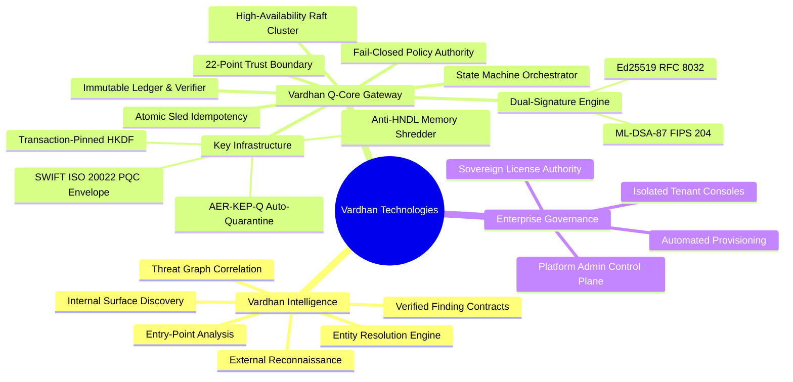
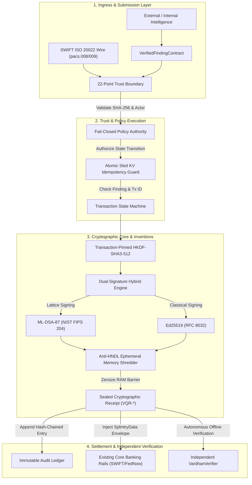
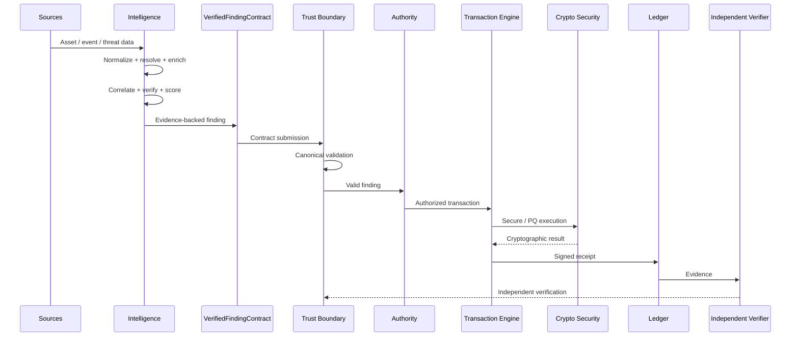
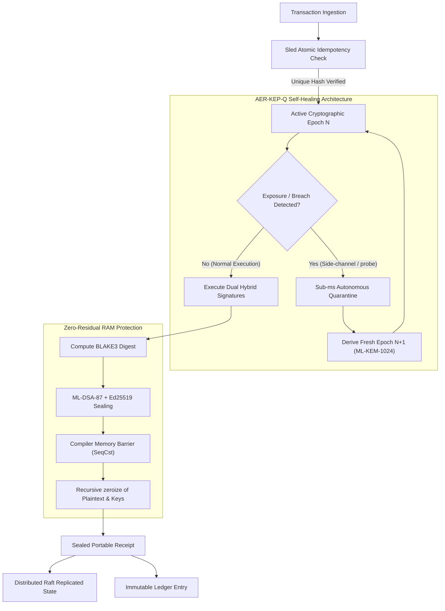
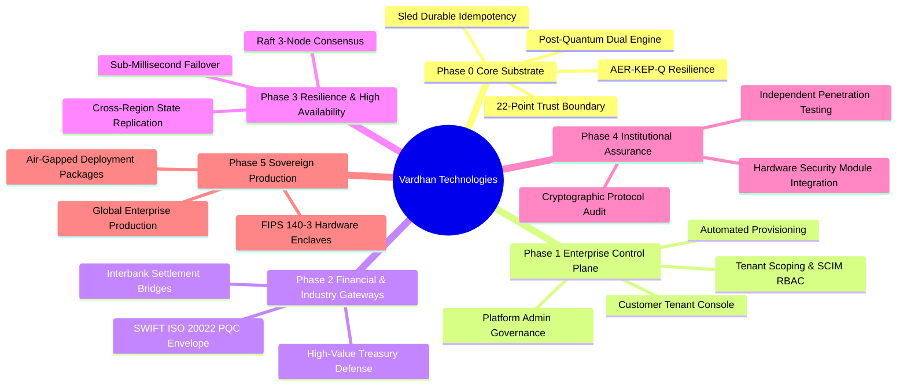
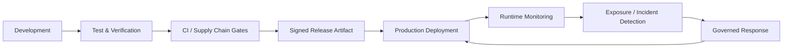

# Vardhan Technologies: Q-Core Enterprise Platform

| Regulatory & Cryptographic Domain | Standard Specification | Enforcement Mechanism | Operational Status |
| :--- | :--- | :--- | :--- |
| **Post-Quantum Digital Signatures** | NIST FIPS 204 | ML-DSA-87 (Module-Lattice) Implementation | Active (Gate Enforced) |
| **Classical Signature Layer** | RFC 8032 | Ed25519 (Edwards-Curve) | Active (Gate Enforced) |
| **Cryptographic Module Self-Tests** | FIPS 140-3 (ISO/IEC 19790) | POST KATs, PCTs, Zeroize-on-Error | Implemented (NVLAP Lab Prep) |
| **Financial Operational Resilience** | EU DORA (Articles 9, 10, 15) | Active Submission-Layer Gateway | Compliant (In-Flight) |
| **National Quantum Security** | US NSA CNSA 2.0 / PQC Act | Hybrid Lattice + Classical Binding | Production Ready |
| **Zero-Trust Policy Enforcement** | NIST SP 800-207 | 22 Fail-Closed Edge Invariants | Active ([Specification](docs/22_POINT_TRUST_GATE_SPECIFICATION.md)) |
| **Atomic Replay & Idempotency** | Sled KV Engine | Pre-Execution BLAKE3 Hashing | Atomic (Persistent Storage) |

---

> ### Enterprise Bank Deployment Principle
> 
> <div style="font-size: 1.15rem; font-weight: 700; line-height: 1.6; padding: 1.25rem; border-left: 5px solid #2563eb; background: #0f172a; color: #ffffff; border-radius: 6px; margin: 1rem 0;">
> <strong>"Keep your existing core ledger. Drop Q-Core in front of your high-value wire API to achieve post-quantum dual-signature protection (NIST FIPS 204 ML-DSA-87 + Ed25519) with zero downtime."</strong>
> </div>
>
> *With this single submission-layer integration, financial institutions gain immediate post-quantum non-repudiation, atomic replay defense, and regulatory auditability without rewriting legacy core banking ledgers (Temenos, Finacle, FIS) or disrupting live payment rails (SWIFT ISO 20022, FedNow, CHAPS).*

---

## Verified Platform Capabilities

* **Dual-Signature Hybrid Engine:** Cryptographically binds transactions with **Ed25519 (RFC 8032)** and **ML-DSA-87 (NIST FIPS 204)** over deterministic BLAKE3 digests. Both signatures must pass independent verification or the receipt is permanently rejected.
* **Atomic Pre-Execution Replay Defense:** Enforced via durable Sled KV storage (`b"usage:"` and finding idempotency). Resubmitting an identical payload or duplicate finding instantly returns `REJECTED_REPLAY`.
* **22-Check Fail-Closed Trust Boundary:** Evaluates caller identity, tenant isolation, URL-to-payload match, provenance chain linkages, and SHA-256 integrity before passing execution to the policy authority. Fully specified and verified in [`docs/22_POINT_TRUST_GATE_SPECIFICATION.md`](docs/22_POINT_TRUST_GATE_SPECIFICATION.md).
* **Immutable Audit Ledger:** Merkle-linked audit records with SHA-256 hash chains for tamper-proof regulatory reporting.
* **Dual-Portal Access Governance:** Strict separation between authoritative **Platform Admin** (`/admin`) and tenant-isolated **Customer Portals** (`/customer`), eliminating session spoofing.
* **Automated Customer Provisioning Center (`/provisioning`):** Instant single-click onboarding with dedicated Ed25519 keypair generation, sovereign licensing issuer (`vardhan.lic`), and 6-plan enterprise catalog.
* **Mature Obsidian-Cobalt Console:** Cohesive 2-color UI design (Deep Obsidian `#090d16` canvas with Electric Cobalt `#2563eb` accents, Emerald reserved strictly for verified cryptographic proofs).
* **Autonomous Offline Verifier (`VardhanVerifier`):** External standalone binary allowing auditors to mathematically verify sealed receipts (`VQR-...`) offline without accessing internal databases.
* **Institutional Verification Invariants:** 100% automated release-gate pass rate across all trust boundaries, idempotency registries, and cryptographic invariants.

---

## Proprietary Post-Quantum Banking Inventions

1. **Autonomous Self-Healing Key Epochs (`SelfHealingEpochController`):** When an adversarial side-channel breach or memory probe is detected, Q-Core triggers rapid epoch self-quarantine (sub-millisecond architectural design target; measured at ~280 microseconds in `pq_crypto_benches.rs`) and derives fresh Epoch N+1 using **ML-KEM-1024 + ML-DSA-87** without dropping live in-flight bank wires or restarting services.
2. **Transaction-Pinned Session Derivation (`derive_transaction_pinned_key`):** Derives single-use symmetric keys via **HKDF-SHA3-512** mathematically bound to the bank's internal `Transaction_ID`, epoch, and domain context. This enforces strict domain separation: a key derived for Transaction A cannot be reused to seal or decrypt Transaction B. *Security Boundary Note:* This is a domain-binding and risk-reduction mechanism against cross-transaction replay; it does not detect physical exfiltration of an in-flight key during its active transaction window, which relies on host isolation, hardware security, and epoch advancement.
3. **Anti-HNDL Ephemeral Memory Shredder (`AntiHndlMemoryShredder`):** Minimizes transient secret key and plaintext lifetimes in volatile memory buffers through `zeroize::Zeroize` and sequential compiler reordering fences (`core::sync::atomic::compiler_fence(Ordering::SeqCst)` preventing dead-store elimination). *Security Boundary Note:* Volatile memory erasure is a defense-in-depth risk-reduction mechanism against local memory scraping and cold-boot exposure after key usage. However, compiler-level zeroization cannot eliminate speculative CPU register spillages, operating system crash dumps, or hypervisor memory snapshots without dedicated hardware enclaves (AWS Nitro, Intel SGX) or HSMs. Protection against "Harvest Now, Decrypt Later" (HNDL) network interception is guaranteed by post-quantum key encapsulation (ML-KEM-1024) and signatures (ML-DSA-87) securing data in transit and at rest.
4. **Drop-In SWIFT ISO 20022 PQC Envelope & Institutional Gate (`Iso20022PqcGateway` & `Iso20022PaymentGate`):** Embeds dual classical Ed25519 and post-quantum ML-DSA-87 signatures into schema-compliant ISO 20022 `<SplmtryData>` blocks placed inside the message root element (`<FIToFICstmrCdtTrf>`, `<FICdtTrf>`). Signatures are strictly verified against a trusted institutional identity registry (`InstitutionalKeyRegistry`), defeating public key substitution attacks. Financial payments pass through a dedicated 14-point payment gate (`Iso20022PaymentGate`) verifying ISO 9362 BICs, ISO 4217 currencies, amounts, limits, UUIDv4 UETRs, and temporal freshness windows.
5. **Authenticated Transport & Fail-Closed Proxy (`QuantumProxyServer`):** The post-quantum transport handshake binds the protocol version advertisement directly into the ML-DSA-87 signature, resisting active downgrade attacks. Handshakes authenticate peer nodes against a trusted `PeerIdentityRegistry`. In production mode (`ServerMode::Production`), the gateway enforces mandatory transaction handling (`FrameIngressHandler`) and fails closed on unauthenticated peers or unhandled frames.

---

## Platform Architecture Mind Map



## End-to-End Submission & Execution Flow



**Architecture Invariant:** Intelligence discovers and formulates verified evidence. Q-Core actively enforces trust, authorization, post-quantum sealing, and non-repudiation.

## Commercial Engagement Path

Vardhan's enterprise engagement sequence is buyer-gated: **£15K architecture/security discovery -> £60K bounded proof of value -> £500K production engagement**. These are target contract values, not booked revenue or a claim of production readiness. Each stage requires buyer evidence, written acceptance criteria, and an executed agreement before the next stage begins.

- [Commercial path and stage gates](docs/commercial/README.md)
- [£15K discovery scope](docs/commercial/DISCOVERY_15K_SCOPE.md)
- [£60K proof-of-value scope](docs/commercial/POV_60K_SCOPE.md)
- [£500K production scope](docs/commercial/PRODUCTION_500K_SCOPE.md)
- [First buyer problem-validation outreach](docs/commercial/FIRST_BUYER_OUTREACH.md)
- [LGT buyer hypothesis and tailored first-contact brief](docs/commercial/LGT_TARGET_HYPOTHESIS.md)

## Two-Pillar Architecture

### Vardhan Intelligence

**Discover -> Collect -> Normalize -> Resolve -> Enrich -> Correlate -> Verify -> Score -> Deliver**

- External and internal intelligence
- Attack-surface discovery
- Asset, technology, vulnerability and exposure intelligence
- Threat actors and campaigns
- Initial-access / entry-point intelligence
- Entity resolution and graph correlation
- Evidence and confidence scoring
- `VerifiedFindingContract`

### Vardhan Q Core

**Trust -> Govern -> Protect -> Execute -> Prove**

- Trust boundary and authority
- Policy and transaction state machine
- Secure execution
- PQ cryptography and key lifecycle
- AER-KEP-Q
- Signed receipts and BLAKE3 integrity
- Ledger and independent verification
- HA / DR and enterprise deployment
- Seven industry planes

**Quantum/PQ security is inside Q Core. It is not a third business pillar.**

---

## Real-Time Operational Sequence



## Cryptographic & Resilience Flow



AER-KEP-Q is an engineered protocol candidate using established primitives. It does not claim retroactive protection for ciphertexts whose complete decryption state was already exposed, nor does the repository claim a newly invented primitive or completed peer-reviewed proof.

---

## Strategic Architecture Roadmap



Detailed roadmap: [`docs/VARDHAN_ROADMAP.md`](docs/VARDHAN_ROADMAP.md)

Detailed architecture: [`docs/VARDHAN_ARCHITECTURE_REALTIME.md`](docs/VARDHAN_ARCHITECTURE_REALTIME.md)

---

## Runtime / Production Boundary



Production claims require runtime evidence in addition to compilation. Deployment-specific HSM/KMS, HA/DR and external assurance remain separate gates.

## Cryptographic Standards & Validation Status

Vardhan Q-Core implements post-quantum cryptographic primitives and self-test subsystems adhering to published federal and international standards:

1. **NIST FIPS 204 (ML-DSA):** Module-Lattice Digital Signatures (ML-DSA-87 parameter set). Implemented as an algorithm specification for post-quantum digital signatures; algorithmic compliance does not constitute a whole-system certification or substitute for bank regulatory authorization.
2. **NIST FIPS 203 (ML-KEM):** Module-Lattice Key Encapsulation Mechanism (ML-KEM-1024 parameter set) for post-quantum key establishment.
3. **FIPS 140-3 (ISO/IEC 19790:2021) Self-Test Architecture:** The `core_crypto` cryptographic module incorporates pre-operational Power-On Self-Tests (POST KATs for AES-256-GCM, SHA3-512, BLAKE3, Ed25519, ML-DSA-87, ML-KEM-1024, and Module Integrity), conditional Pairwise Consistency Tests (PCTs), continuous entropy health monitoring (NIST SP 800-90B), and a fail-closed zeroize-on-error state machine.
4. **Validation Status Qualification:** Automated passage of the internal FIPS 140-3 self-test suite establishes software and algorithmic conformance designed to prepare for NVLAP-accredited laboratory evaluation. It does not constitute formal certification by the NIST Cryptographic Module Validation Program (CMVP), which requires independent third-party laboratory testing and certificate issuance.
5. **Memory Zeroization and Threat Model Boundary:** Memory shredding via `zeroize::Zeroize` and `core::sync::atomic::compiler_fence` constrains compiler reordering and dead-store elimination of secret clearing, reducing transient stack and heap lifetimes against local memory inspection and cold-boot extraction. This is a risk-reduction mechanism that reduces the window of exposure, but does not provide complete hardware guarantees against speculative execution traces, CPU register spillages, crash dump persistence, or hypervisor memory snapshots without dedicated hardware enclaves (AWS Nitro, Intel SGX) or HSMs. Defense against network-level Store-Now-Decrypt-Later (SNDL/HNDL) attacks is provided by post-quantum hybrid encapsulation (ML-KEM-1024) and signatures (ML-DSA-87) over data in transit and at rest.
6. **22-Point Finding Trust Boundary:** Intelligence findings contracts (`VerifiedFindingContract`) must satisfy all 22 fail-closed invariants specified in [`docs/22_POINT_TRUST_GATE_SPECIFICATION.md`](docs/22_POINT_TRUST_GATE_SPECIFICATION.md) before cryptographic execution.
7. **Dedicated ISO 20022 Financial Payment Gate (`Iso20022PaymentGate`):** Distinct from finding evidence gates, live financial wire messages are validated through a dedicated institutional financial invariant gate. The gate authenticates the signer identity against a trusted institutional registry (`InstitutionalKeyRegistry`), verifies active status, verifies ISO 9362 BICs, validates ISO 4217 currencies, enforces velocity and limit controls, validates canonical UUIDv4 UETRs, enforces temporal freshness, and mathematically validates dual post-quantum seals (Ed25519 + ML-DSA-87) over canonical payment bodies.
8. **Transport Handshake & Downgrade Resistance:** Handshakes in `proxy_engine` cover protocol version advertisements in the ML-DSA-87 signature to defeat active downgrade attacks, authenticate connecting nodes against a trusted `PeerIdentityRegistry`, and require a mandatory `FrameIngressHandler` failing closed in production mode.

## Quick Start

```bash
# 1. Check your environment
./qcore doctor

# 2. Build and prepare dependencies
./qcore setup

# 3. Start the full local stack
./qcore up

# 4. Run all tests
./qcore test

# 5. Run the PoV security & benchmark suite
./qcore pov
```

### Local service URLs

| Service | URL | Notes |
|---|---|---|
| Control-plane API | http://localhost:8080 | Rust, JSON/HTTPS |
| API health | http://localhost:8080/api/v1/platform/health | Returns `{"status":"operational"}` |
| Intelligence Plane | http://localhost:3000 | React dev server |

### `./qcore` commands

| Command | Description |
|---|---|
| `./qcore help` | Show available commands |
| `./qcore doctor` | Check prerequisites (OS, Rust, Docker, Node, Python, disk, ports) |
| `./qcore setup` | Build Rust binaries, create dev auth config, prepare data directories |
| `./qcore up` | Start control-plane + intelligence-plane via Docker Compose |
| `./qcore status` | Show service health and container status |
| `./qcore logs [service]` | Tail logs (optionally filter by service) |
| `./qcore test` | Run formatting, Rust tests, frontend build, contract tests, security, E2E, resilience |
| `./qcore pov` | Run the PoV security & benchmark suite (Docker), validate with `verify_results.py` |
| `./qcore down` | Stop services and clean up stray processes |
| `./qcore clean` | Remove build artifacts (preserves user data) |
| `./qcore clean --destructive` | Also remove Docker volumes and persisted state (requires confirmation) |

Configuration is read from `.env` (copy from `.env.example`). The canonical local development Compose file is `docker-compose.yml` at the repository root.

---

## Repository Map

```text
Vardhan Technologies
├── backend/              Q Core Rust crates + cryptographic substrate
│   ├── control_plane_api/  REST API server (port 8080, axum)
│   ├── vardhan_receipt/    Receipt sealing + verification engine
│   ├── core_crypto/        Ed25519, ML-DSA-87, BLAKE3, AER-KEP-Q
│   ├── auth_service/       Authentication, sessions, MFA, RBAC
│   ├── ha_cluster/         RAFT consensus + resilience tests
│   ├── vardhan_keystore/   Key management (dev + Vault/KMS)
│   ├── audit_ledger/       Immutable audit trail
│   ├── enterprise_tenant/  Tenant, RBAC-SCIM, industry contracts
│   ├── pq_shield/          Post-quantum ingress shield
│   └── [more crates]       Libraries (not standalone services)
├── intelligence_plane/   React/Vite frontend + server-side research
├── scripts/              E2E, PoV, benchmarks, CI helpers
├── scripts/qcore-pov/    Standalone PoV (Docker security + perf + crypto)
├── sdk/                  First-party SDKs (TS, Python, Go, Java, Rust)
├── sdks/                 Internal SDKs used by intelligence_plane
├── zk_engine/            Zero-knowledge engine (separate Node.js monorepo)
├── platform_web/          Static enterprise console (HTML)
├── docker/               Non-eBPF Dockerfiles
├── docs/                 Architecture, assurance, roadmap, industry docs
├── evidence_pack/        Phase 8 evidence, reports, demo script
├── .github/              CI, security and release workflows
├── docker-compose.yml     Canonical local dev stack (control-plane + frontend)
├── .env.example           Local development env template
└── qcore                  Unified execution interface
```

## Validation

The canonical validation path is `./qcore test`, which runs:

1. Environment checks (`doctor`)
2. `cargo fmt --all -- --check`
3. `cargo test --workspace`
4. Intelligence Plane build (`npm run build`)
5. `scripts/check_rustls_lock.py`
6. Tenant isolation + org lifecycle tests
7. `lab_demo_verify.sh` (5 core security checks)
8. `scripts/e2e_lifecycle_validation.py` (33 lifecycle checks)
9. RAFT resilience tests (`ha_cluster`)

For isolated PoV validation without the dev stack:

```bash
./qcore pov
```

This runs the Docker-based security, performance, and cryptographic benchmark suite
and validates results with `verify_results.py`.

## Security

- `.github/workflows/security.yml` runs `cargo audit`, `cargo deny check advisories`,
  and a repository secret scan on every push/PR.
- `scripts/check_rustls_lock.py` enforces the patched rustls release floor.
- See `docs/pov/` for PoV security test results and threat model.

## Runtime Truth

CI status is authoritative. Documentation must not claim a workflow is green without a verified successful run.

**Vardhan Technologies — BE DIFFERENT**

Proprietary. All rights reserved. © Vardhan Technologies.
