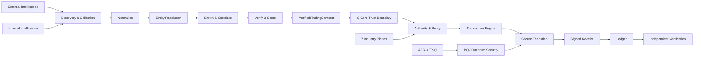
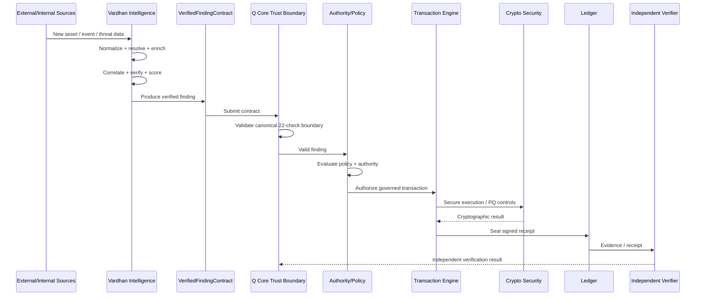
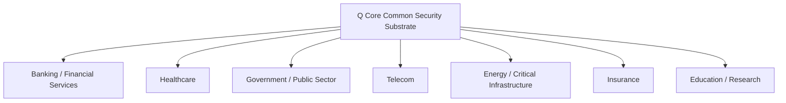
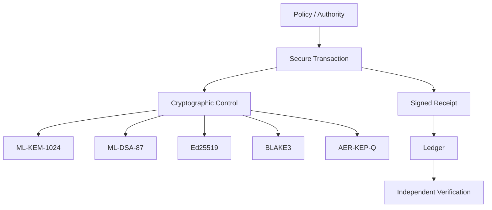
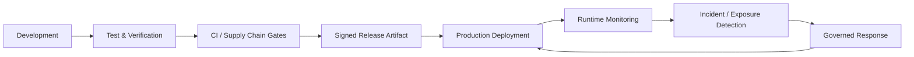
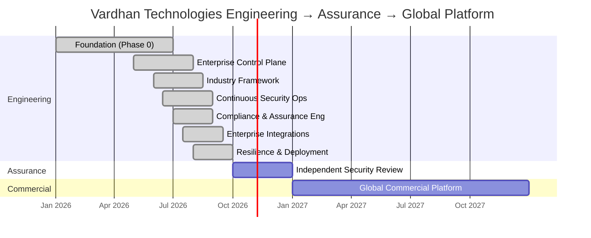

# Vardhan Technologies

> **BE DIFFERENT**

Security infrastructure for regulated enterprises, banks, and high-consequence digital operations.

Vardhan Technologies combines **Vardhan Intelligence** and **Vardhan Q Core** into one governed security platform.

---

## How Vardhan Actually Works



**In simple terms:** Intelligence discovers and proves what is happening. Q Core decides what is trusted, authorized, executed, and provable.

## Two-Pillar Architecture

### 1. Vardhan Intelligence

**Discover → Collect → Normalize → Resolve → Enrich → Correlate → Verify → Score → Deliver**

- External intelligence
- Internal intelligence
- Attack-surface discovery
- Asset and technology intelligence
- Vulnerability and exposure intelligence
- Threat-actor and campaign intelligence
- Initial-access / entry-point intelligence
- Entity resolution and graph correlation
- Evidence and confidence scoring
- `VerifiedFindingContract` delivery

### 2. Vardhan Q Core

**Trust → Govern → Protect → Execute → Prove**

- Versioned trust boundary
- Authority and policy enforcement
- Transaction state machine
- Secure execution
- Post-quantum cryptography
- Key lifecycle and protection
- AER-KEP-Q
- Signed receipts and BLAKE3 integrity
- Ledger and independent verification
- HA / DR / enterprise deployment controls
- Seven industry planes

**Quantum/PQ security is inside Q Core. It is not a third business pillar.**

---

## Real-Time Finding Lifecycle



The upstream intelligence label is **never treated as sufficient trust by itself**. The Q Core boundary independently validates the contract before governed execution.

---

## Seven Industry Planes

All seven industries use the same Q Core security substrate; each plane adds domain-specific assets, workflows, policies, controls, risk models, integrations, dashboards, reporting, and deployment templates.



---

## Security & Cryptographic Layer



AER-KEP-Q provides authenticated epochs, ML-KEM session establishment, transcript binding, replay protection, exposure detection, quarantine, fresh-epoch recovery, descriptor validation, and rollback protection.

It deliberately does **not** claim retroactive protection for ciphertexts whose complete decryption state was already exposed. That epoch is quarantined and new traffic moves to a fresh authenticated epoch.

AER-KEP-Q is an engineered protocol candidate built from established primitives; it is not presented as a newly invented primitive or completed peer-reviewed proof.

---

## Runtime / Production Boundary



Production claims require runtime evidence in addition to compilation. The repository validates Rust, Intelligence Plane, trust-boundary integration, Linux eBPF, supply chain, and release controls in CI; deployment-specific HSM/KMS, HA/DR, and external assurance remain separate concerns.

---

## Repository Map

```text
Vardhan Technologies
│
├── backend/              Q Core Rust services + cryptographic substrate
├── intelligence_plane/   Vardhan Intelligence + evidence/verification
├── contracts/            Versioned platform contracts
├── sdks/                 TypeScript + Python SDKs
├── zk_engine/            Zero-knowledge engine
├── runtime/              Short operational status/reports
├── docs/                 Architecture, assurance, roadmap, industry docs
└── .github/              CI, security and release workflows
```

Detailed visual architecture: [`docs/VARDHAN_ARCHITECTURE_REALTIME.md`](docs/VARDHAN_ARCHITECTURE_REALTIME.md)

Product roadmap: [`docs/VARDHAN_ROADMAP.md`](docs/VARDHAN_ROADMAP.md)

---

## Roadmap



The dates above are planning visualization only, not delivery guarantees. See the roadmap document for evidence-backed status and gates.

---

## Validation

### Rust

```bash
cargo fmt --all -- --check
cargo test --workspace
cargo build --workspace --release
```

### Intelligence Plane

```bash
cd intelligence_plane
npm install
npx tsc -p tsconfig.xavira.json --noEmit
npx tsx tests/trust_boundary.test.ts
npx vitest run
```

### Security / Supply Chain

```bash
cargo audit
cargo deny check advisories
```

### Linux eBPF

Kernel and userspace components are compiled together in CI. Production runtime configuration uses `EBPF_OBJECT_PATH` and `EBPF_INTERFACE`.

---

## Runtime Truth

`runtime/` is intentionally small:

```text
runtime/
├── report.md
├── status.md
├── tests.md
└── errors.md
```

CI status is authoritative. Documentation must not claim a workflow is green without a verified successful run.

---

## Security Position

Vardhan Q Core is security infrastructure and a cryptographic control plane—not a collection of unrelated algorithms. Security claims are bounded by implementation evidence, test evidence, deployment configuration, and independent assurance status.

**Vardhan Technologies — BE DIFFERENT**

Proprietary. All rights reserved. © Vardhan Technologies.
