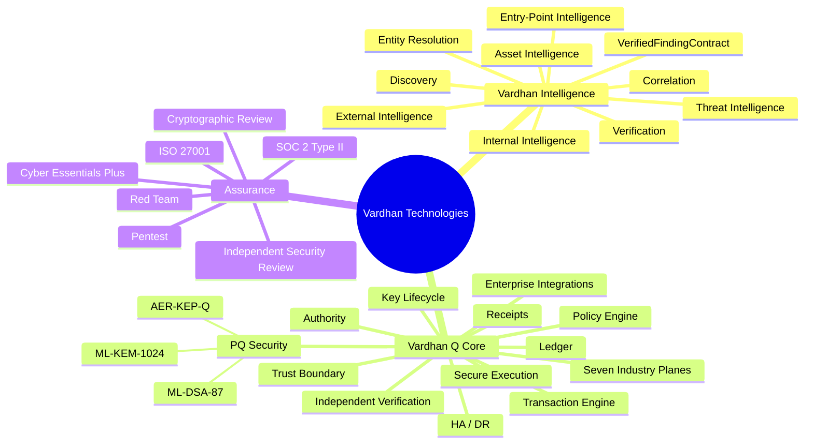
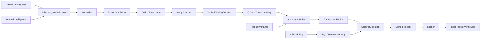
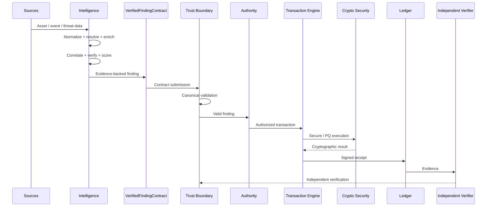
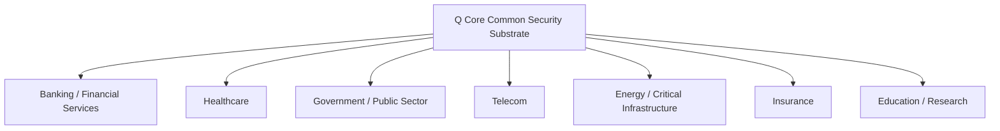
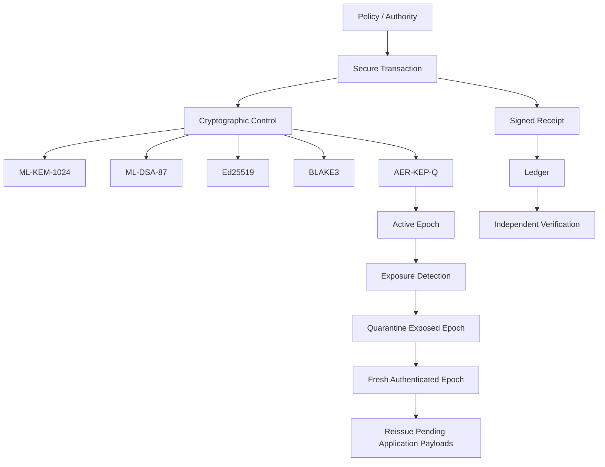
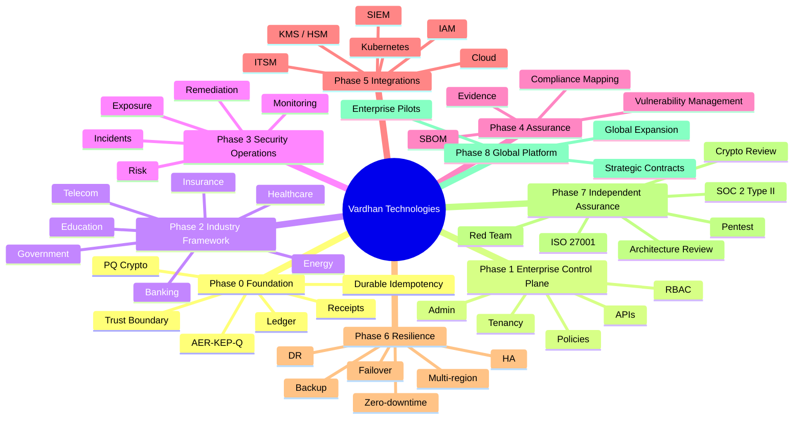
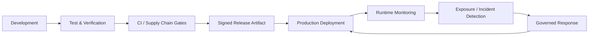

# Vardhan Technologies

> **BE DIFFERENT**

**Post-quantum security infrastructure for regulated enterprises, banks, and high-consequence digital operations.**

Vardhan Technologies combines **Vardhan Intelligence** and **Vardhan Q Core** into one governed security platform.

## Assurance & Certification Roadmap

> These are **target assurance outcomes**, not certifications already held. Badges become claimable only after the corresponding assessment, certification or attestation is actually completed.

| Assurance | Purpose | Target status |
|---|---|---|
|  | Baseline UK cyber controls | Planned |
|  | Independently tested baseline controls | Planned |
|  | Information security management system | Planned |
|  | Operating effectiveness of security controls | Planned |
|  | Payment-card environments where applicable | Applicable deployments |
|  | Control and assurance mapping | Engineering mapping |
|  | External technical validation | Required |
|  | Independent review of cryptographic design | Required |

**Important:** Vardhan does not use target badges as proof of certification. Formal certificates, reports and attestations will be published only when issued by the relevant independent assessor or certification body.

---

## Platform Mind Map



## How Vardhan Actually Works



**In simple terms:** Intelligence discovers and proves what is happening. Q Core decides what is trusted, authorized, protected, executed, and provable.

## Commercial Engagement Path

Vardhan's target enterprise engagement sequence is buyer-gated: **£15K architecture/security discovery → £60K bounded proof of value → £500K production engagement**. These are target contract values, not booked revenue or a claim of production readiness. Each stage requires buyer evidence, written acceptance criteria, and an executed agreement before the next stage begins.

- [Commercial path and stage gates](docs/commercial/README.md)
- [£15K discovery scope](docs/commercial/DISCOVERY_15K_SCOPE.md)
- [£60K proof-of-value scope](docs/commercial/POV_60K_SCOPE.md)
- [£500K production scope](docs/commercial/PRODUCTION_500K_SCOPE.md)
- [First buyer problem-validation outreach](docs/commercial/FIRST_BUYER_OUTREACH.md)
- [LGT buyer hypothesis and tailored first-contact brief](docs/commercial/LGT_TARGET_HYPOTHESIS.md)

## Two-Pillar Architecture

### Vardhan Intelligence

**Discover → Collect → Normalize → Resolve → Enrich → Correlate → Verify → Score → Deliver**

- External and internal intelligence
- Attack-surface discovery
- Asset, technology, vulnerability and exposure intelligence
- Threat actors and campaigns
- Initial-access / entry-point intelligence
- Entity resolution and graph correlation
- Evidence and confidence scoring
- `VerifiedFindingContract`

### Vardhan Q Core

**Trust → Govern → Protect → Execute → Prove**

- Trust boundary and authority
- Policy and transaction state machine
- Secure execution
- PQ cryptography and key lifecycle
- AER-KEP-Q
- Signed receipts and BLAKE3 integrity
- Ledger and independent verification
- HA / DR and enterprise deployment
- Seven industry planes

**Quantum/PQ security is inside Q Core. It is not a third business pillar.**

---

## Real-Time Operational Flow



## Seven Industry Planes



Each plane uses the common Q Core substrate while adding domain-specific assets, threat models, workflows, policies, controls, risk models, integrations, dashboards, reporting and deployment templates.

## Cryptographic & Resilience Flow



AER-KEP-Q is an engineered protocol candidate using established primitives. It does not claim retroactive protection for ciphertexts whose complete decryption state was already exposed, nor does the repository claim a newly invented primitive or completed peer-reviewed proof.

---

## Roadmap Mind Map



Detailed roadmap: [`docs/VARDHAN_ROADMAP.md`](docs/VARDHAN_ROADMAP.md)

Detailed architecture: [`docs/VARDHAN_ARCHITECTURE_REALTIME.md`](docs/VARDHAN_ARCHITECTURE_REALTIME.md)

---

## Runtime / Production Boundary



Production claims require runtime evidence in addition to compilation. Deployment-specific HSM/KMS, HA/DR and external assurance remain separate gates.

## Quick Start

```bash
# 1. Check your environment
./qcore doctor

# 2. Build and prepare dependencies
./qcore setup

# 3. Start the full local stack
./qcore up

# 4. Run all tests
./qcore test

# 5. Run the PoV security & benchmark suite
./qcore pov
```

### Local service URLs

| Service | URL | Notes |
|---|---|---|
| Control-plane API | http://localhost:8080 | Rust, JSON/HTTPS |
| API health | http://localhost:8080/api/v1/platform/health | Returns `{"status":"operational"}` |
| Intelligence Plane | http://localhost:3000 | React dev server |

### `./qcore` commands

| Command | Description |
|---|---|
| `./qcore help` | Show available commands |
| `./qcore doctor` | Check prerequisites (OS, Rust, Docker, Node, Python, disk, ports) |
| `./qcore setup` | Build Rust binaries, create dev auth config, prepare data directories |
| `./qcore up` | Start control-plane + intelligence-plane via Docker Compose |
| `./qcore status` | Show service health and container status |
| `./qcore logs [service]` | Tail logs (optionally filter by service) |
| `./qcore test` | Run formatting, Rust tests, frontend build, contract tests, security, E2E, resilience |
| `./qcore pov` | Run the PoV security & benchmark suite (Docker), validate with `verify_results.py` |
| `./qcore down` | Stop services and clean up stray processes |
| `./qcore clean` | Remove build artifacts (preserves user data) |
| `./qcore clean --destructive` | Also remove Docker volumes and persisted state (requires confirmation) |

Configuration is read from `.env` (copy from `.env.example`). The canonical local development Compose file is `docker-compose.yml` at the repository root.

---

## Repository Map

```text
Vardhan Technologies
├── backend/              Q Core Rust crates + cryptographic substrate
│   ├── control_plane_api/  REST API server (port 8080, axum)
│   ├── vardhan_receipt/    Receipt sealing + verification engine
│   ├── core_crypto/        Ed25519, ML-DSA-87, BLAKE3, AER-KEP-Q
│   ├── auth_service/       Authentication, sessions, MFA, RBAC
│   ├── ha_cluster/         RAFT consensus + resilience tests
│   ├── vardhan_keystore/   Key management (dev + Vault/KMS)
│   ├── audit_ledger/       Immutable audit trail
│   ├── enterprise_tenant/  Tenant, RBAC-SCIM, industry contracts
│   ├── pq_shield/          Post-quantum ingress shield
│   └── [more crates]       Libraries (not standalone services)
├── intelligence_plane/   React/Vite frontend + server-side research
├── scripts/              E2E, PoV, benchmarks, CI helpers
├── scripts/qcore-pov/    Standalone PoV (Docker security + perf + crypto)
├── sdk/                  First-party SDKs (TS, Python, Go, Java, Rust)
├── sdks/                 Internal SDKs used by intelligence_plane
├── zk_engine/            Zero-knowledge engine (separate Node.js monorepo)
├── platform_web/          Static enterprise console (HTML)
├── docker/               Non-eBPF Dockerfiles
├── docs/                 Architecture, assurance, roadmap, industry docs
├── evidence_pack/        Phase 8 evidence, reports, demo script
├── .github/              CI, security and release workflows
├── docker-compose.yml     Canonical local dev stack (control-plane + frontend)
├── .env.example           Local development env template
└── qcore                  Unified execution interface
```

## Validation

The canonical validation path is `./qcore test`, which runs:

1. Environment checks (`doctor`)
2. `cargo fmt --all -- --check`
3. `cargo test --workspace`
4. Intelligence Plane build (`npm run build`)
5. `scripts/check_rustls_lock.py`
6. Tenant isolation + org lifecycle tests
7. `lab_demo_verify.sh` (5 core security checks)
8. `scripts/e2e_lifecycle_validation.py` (33 lifecycle checks)
9. RAFT resilience tests (`ha_cluster`)

For isolated PoV validation without the dev stack:

```bash
./qcore pov
```

This runs the Docker-based security, performance, and cryptographic benchmark suite
and validates results with `verify_results.py`.

## Security

- `.github/workflows/security.yml` runs `cargo audit`, `cargo deny check advisories`,
  and a repository secret scan on every push/PR.
- `scripts/check_rustls_lock.py` enforces the patched rustls release floor.
- See `docs/pov/` for PoV security test results and threat model.

## Runtime Truth

CI status is authoritative. Documentation must not claim a workflow is green without a verified successful run.

**Vardhan Technologies — BE DIFFERENT**

Proprietary. All rights reserved. © Vardhan Technologies.
