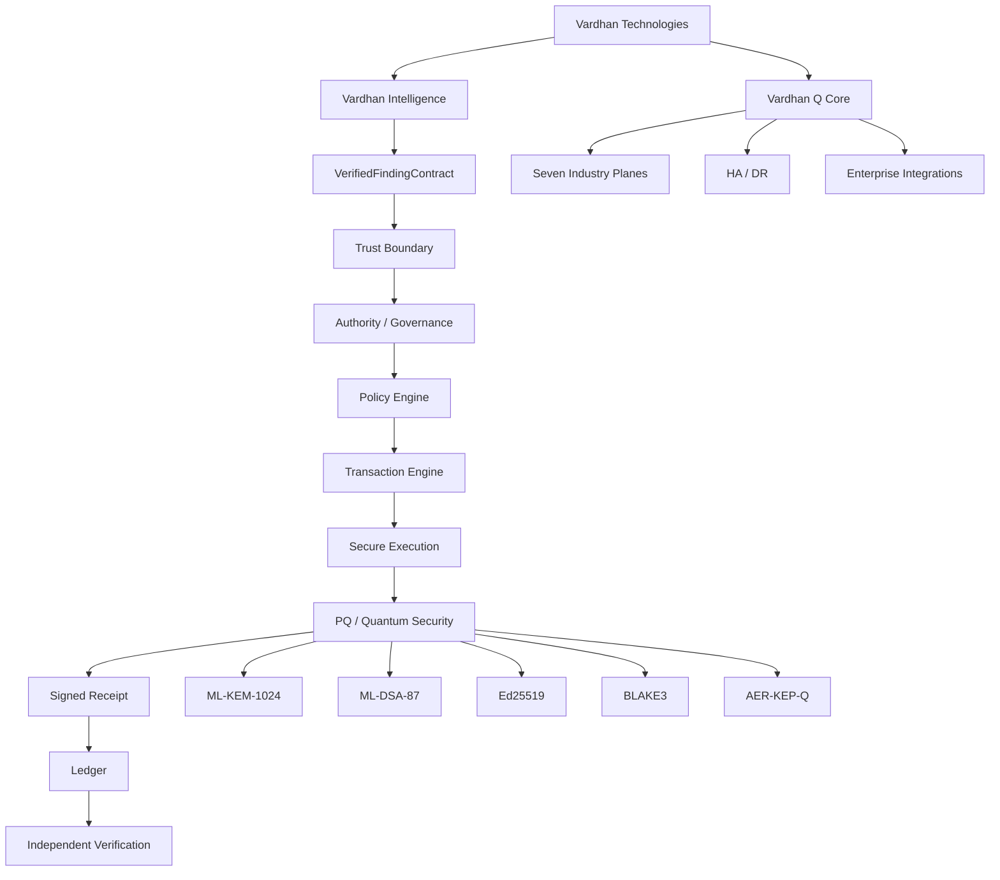
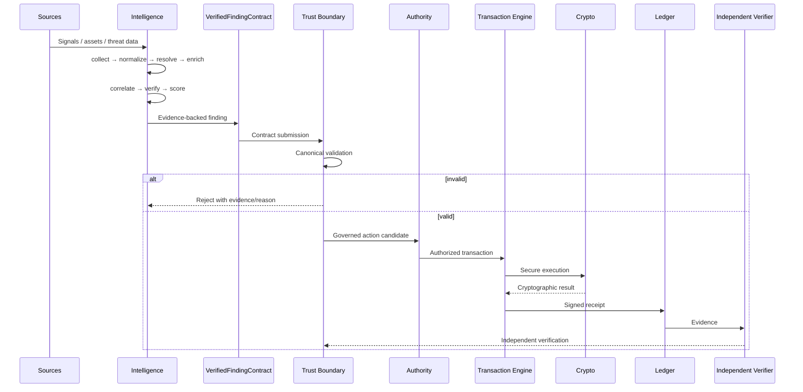
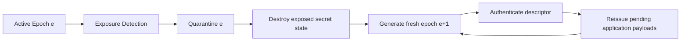
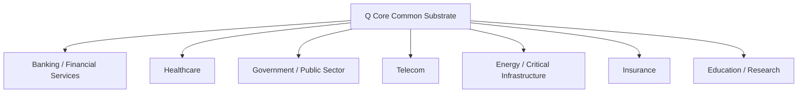

# Vardhan Technologies — Current Backend Architecture Audit

**Status:** Current repository architecture reference  
**Branch:** `main`  
**Architecture:** Two pillars  

> This file is the technical backend reference. For the visual system view use [`VARDHAN_ARCHITECTURE_REALTIME.md`](./VARDHAN_ARCHITECTURE_REALTIME.md). For the product roadmap use [`VARDHAN_ROADMAP.md`](./VARDHAN_ROADMAP.md).

## 1. Canonical Product Architecture

Quantum/PQ security is a Q Core capability, not a third business pillar.

## 2. Runtime Data Flow

## 3. Trust Boundary

The Intelligence → Q Core boundary consumes the canonical `VerifiedFindingContract`. The current validation model contains **22 checks** covering schema, identity, evidence, temporal state, hashes, contradiction/differential state, materiality, provenance, authorization, engine/domain identity, entry-point metadata, verification linkage, governed action candidates, and registered policy references.

The Rust and TypeScript validation paths must remain aligned. Contract changes require regression tests on both sides.

## 4. Cryptographic Security

The repository's existing receipt/trust architecture remains authoritative. The current Q Core cryptographic capability includes ML-KEM-1024 and ML-DSA-87, with AER-KEP-Q providing authenticated epoch lifecycle, exposure quarantine, fresh-epoch recovery, replay protection, descriptor validation, and rollback protection.

AER-KEP-Q is an engineered protocol candidate using standardized cryptographic primitives. The repository does not claim a universally novel cryptographic primitive or a complete QROM proof.

## 5. AER-KEP-Q Runtime Boundary

Full-state exposure cannot retroactively protect ciphertexts created under an already exposed epoch. Pending application messages require application-level retransmission/reissue under the fresh epoch.

## 6. Runtime Truth

Production claims require runtime evidence. Build success alone does not prove deployment correctness.

Required verification layers:

1. Rust workspace formatting/build/tests.
2. Intelligence Plane typecheck/build/tests.
3. Q Core trust-boundary integration tests.
4. Linux eBPF kernel compilation.
5. Linux eBPF userspace loader compilation.
6. eBPF kernel/userspace ABI compatibility.
7. Supply-chain audit, dependency policy, SBOM, and secret scanning.
8. Release artifact signing and verification.
9. Deployment-specific HA/HSM/KMS validation.

## 7. eBPF ABI Contract

The kernel object and userspace loader must agree on:

- XDP program symbol: `vardhan_firewall`.
- Allowed-peer map: `ALLOWED_PEERS`.
- Allowed-peer key: IPv4 `u32`.
- Allowed-peer value: `u32`.
- Runtime object path: configurable through `EBPF_OBJECT_PATH`.
- Runtime network interface: configurable through `EBPF_INTERFACE`.

Any change to this ABI requires both kernel and userspace changes plus Linux CI compilation.

## 8. CI / Release Truth

The repository root is the Cargo workspace root. CI commands that operate on the workspace must execute from the repository root rather than `backend/`.

The enterprise release workflow produces a cryptographically signed artifact using Sigstore/Cosign and publishes its BLAKE3 digest. It does **not** claim SLSA Level 3 certification unless an actual SLSA provenance generation and verification pipeline is present.

GitHub Actions workflow status is the authoritative CI state. Runtime documentation must not claim green status without a verified successful run.

## 9. Seven Industry Planes

The industry planes share common trust, cryptographic, governance, transaction, evidence, and integration infrastructure.

## 10. Security Boundaries and Known Limits

- Full-state exposure cannot retroactively protect ciphertexts created under an already exposed epoch.
- HSM/KMS deployment and production key custody remain deployment/assurance concerns.
- Independent external security review is separate from repository CI.
- Industry compliance mappings do not constitute certification by themselves.
- Production readiness requires runtime and deployment evidence, not only source compilation.

## 11. Change Discipline

Do not create a third product pillar for quantum security. Do not duplicate trust-boundary implementations. Do not label simulations as production implementations. Do not use historical audit reports as evidence for the current repository.

When runtime architecture changes, update this audit and the visual architecture document in the same change.
