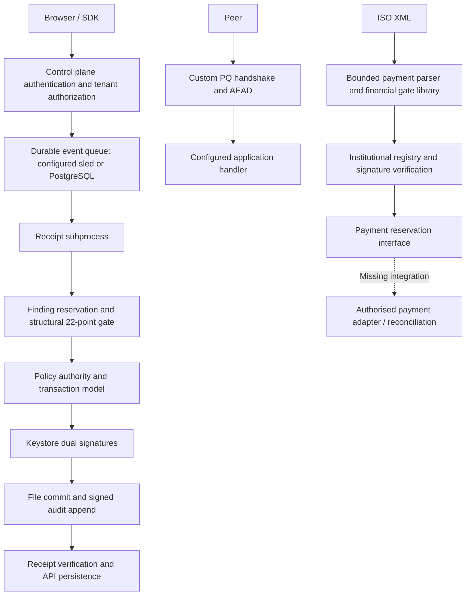

# Production architecture and implemented boundaries

Status: **NOT PRODUCTION READY**, reviewed from baseline `f7c0dc823cebb6338e3e7f4577884483321db80b` (and `main` branch HEAD).

## Actual architecture

The required caller-to-settlement pipeline is a target, not an implemented continuous
path. Finding sealing does not authorize payments. The ISO payment library and proxy
callback do not establish an authorised bank adapter. Production proxy mode checks
for a handler and peer registry; development APIs and `quantum_node` are not a
production payment ingress. Generic ACK fallback has been removed. QuantumProxyServer defaults to Production; release builds enforce registry presence even if Development is requested.

## Interface map

| Responsibility | Existing interface/module | Remaining boundary |
|---|---|---|
| Transport | proxy_engine framing, handshake, AeadTransport; axum API | reviewed mutual authentication and deployment policy |
| Identity / tenant | auth_service, enterprise_tenant, policy_authority | end-to-end payment caller/tenant/application/role binding |
| Finding validation | TrustBoundaryValidator | evidence byte resolver and provenance existence checks |
| Payment validation | Iso20022PaymentGate | official XSD, market profile, exact-decimal limits, bank controls |
| Policy | GatewayAuthorityEvaluator / PaymentPolicy | approved versioned production policy and administrative approvals |
| Crypto | core_crypto / vardhan_keystore | independent protocol review and deployed key custody |
| Replay | receipt reservation, queue stores, PaymentIdempotencyStore | one authoritative transaction boundary across nodes/adapters |
| Execution | FrameIngressHandler | authorised handler, destination and unknown-outcome reconciliation |
| Audit | audit_ledger / receipt audit_trail | concurrent-writer guarantees and independent anchoring |
| HA | ha_cluster Raft, ledger applier | complete admission-to-outcome consistency proof |
| Offline verify | vardhan_verifier library, pq_verify executable | trusted key distribution and receipt semantics per format |
| Administration | control_plane_api provisioning/auth routes | MFA enforcement, two-person sensitive-change approvals and audit evidence |

## State and response contract

`vardhan_transaction::TransactionState` supplies Requested → Validating →
AuthorityEvaluation → Authorized → Executing → Executed → OutcomeRecorded → Receipted,
with Rejected, ValidationFailed and Failed terminal alternatives. This is a model,
not an atomic database transaction spanning execution, signatures and audit storage.

| Boundary | Preconditions | Durable effect | Failure response |
|---|---|---|---|
| Finding reservation | valid file identifier, no committed/in-flight record | exclusive file + file/directory sync | deny; ambiguous storage failure remains reserved |
| Validation | structural contract and trusted tenant/actor policy | no receipt | rejection; pre-execution reservation may be released |
| Sealing | authority decision allows finding sealing | cryptographic receipt constructed in memory | failure/unknown, never settlement acknowledgement |
| Commit | reservation owned, receipt constructed | synced reservation renamed to committed flag; directory synced | OUTCOME_UNKNOWN; retain replay barrier |
| Audit | committed flag, signing key available | audit append and fsync | OUTCOME_UNKNOWN; reconciliation required |
| API storage | independently verified receipt | route/queue specific persistence | must not treat lost response as permission to execute again |

Received, authenticated, validated and authorised are separate facts. Accepted for
processing is not dispatched. Dispatched is not confirmed. Unknown outcomes must
be reconciled with the authorised downstream system before retry. No settlement
claim is permitted from a finding receipt or generic ACK.

## Required production startup gate (incomplete)

Ingress must require authenticated peer/caller identity, authoritative trusted-key
source, approved policy, durable storage, approved adapter and audit sink. Missing
or stale dependencies must deny admission. Existing partial checks are insufficient
to approve deployment. Do not wire a mock handler to satisfy startup checks.
