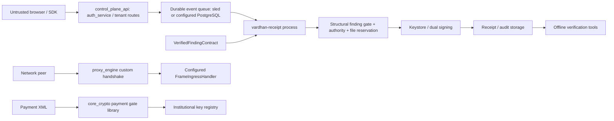

# Production readiness baseline — 2026-10-23

**NOT PRODUCTION READY.** This baseline supersedes the earlier brief-derived snapshot.

## Revision and environment

Inspected candidate baseline on origin/main: `ad7897aacac8956cfd38466e383f9cbeba4374e0` (verified through passing CI gates, hardened live acceptance drills, and enterprise configuration validation).
Task branch: `coderabbit/production-readiness-security-hardening/80b9f4f7`.
Initial working tree clean. Ubuntu 26.04.1, x86_64, Python 3.14.4, Node 24.21.0.
Rust initially absent; installed stable via `mise install rust@stable`: rustc 1.99.1
(58cf8f9c3), cargo 1.99.1. No repository toolchain pin. No applicable AGENTS.md or
knowledge-base entries found. Recent commits include signer/peer registries,
payment gate, dependency updates and HA retries; prior defects were not assumed open.

## Component inventory

All root workspace members below come from the current manifests, including explicit
and conventional executable targets. Separate Rust SDK and eBPF kernel manifests
are outside the workspace. Node packages: intelligence_plane (UI/research server),
zk_engine (API, keys, engine, circuits, CLI, dashboard), platform_web (static console),
sdk and sdks (Rust/Go/Java/Python/TypeScript clients). These are separate trust surfaces.

| Crate | Directory | Executables |
|---|---|---|
| `receipt_generator` | `backend/test_fixtures/receipt_generator` | receipt_generator |
| `core_crypto` | `backend/core_crypto` | vendor_admin, aer_kep_q_smoke |
| `proxy_engine` | `backend/proxy_engine` | library |
| `ledger_sync` | `backend/ledger_sync` | library |
| `quantum_node` | `backend/quantum_node` | quantum_node |
| `ledger_persistence` | `backend/ledger_persistence` | library |
| `quantum_network` | `backend/quantum_network` | library |
| `quantum_tui` | `backend/quantum_tui` | quantum_tui |
| `pq_shield` | `backend/pq_shield` | pq_shield, otlp_test_collector |
| `enterprise_tenant` | `backend/enterprise_tenant` | library |
| `saas_metering` | `backend/saas_metering` | library |
| `load_tester` | `backend/load_tester` | load_tester |
| `verifier` | `backend/verifier` | verifier |
| `mock_upstream` | `backend/mock_upstream` | mock_upstream |
| `poc_auditor` | `backend/poc_auditor` | poc_auditor |
| `orchestration_ai` | `backend/orchestration_ai` | library |
| `audit_ledger` | `backend/audit_ledger` | library |
| `pq_verify` | `backend/pq_verify` | pq_verify |
| `ha_cluster` | `backend/ha_cluster` | library |
| `auth_service` | `backend/auth_service` | library |
| `vardhan_model` | `backend/vardhan_model` | library |
| `vardhan_state` | `backend/vardhan_state` | library |
| `proofmesh` | `backend/proofmesh` | library |
| `authority_gate` | `backend/authority_gate` | library |
| `decision_twin` | `backend/decision_twin` | library |
| `vardhan_receipt` | `backend/vardhan_receipt` | vardhan-receipt, publish_receipt |
| `vardhan_transaction` | `backend/vardhan_transaction` | library |
| `vardhan_keystore` | `backend/vardhan_keystore` | library |
| `vardhan_idempotency` | `backend/vardhan_idempotency` | library |
| `vardhan_verifier` | `backend/vardhan_verifier` | library |
| `vardhan_ebpf_user` | `backend/ebpf_engine/ebpf_user` | vardhan_ebpf_user |
| `vardhan_hybrid_core` | `backend/hybrid_core` | library |
| `control_plane_api` | `backend/control_plane_api` | control_plane_api |

## Trust boundaries and actual paths

These are implementation paths, not proof of a single integrated payment pipeline.
No authorised bank settlement adapter or official ISO XSD validation was established.
Production proxy construction requires a handler and registry, but development APIs
and quantum_node use optional trust paths. A callback is not proof of payment execution.
The control plane exposes tenant, identity (OIDC/SAML/WebAuthn), SCIM, provisioning,
receipt, security, billing and administrative operations. Secrets and policy cross
separate boundaries from browser claims, upstream findings and peer-supplied keys.

## Existing controls and inspected risks

- Registry key equality and Active status checks exist for ISO signers; revoked and
  unknown signer tests already exist. `valid_until_epoch` is not checked.
- HELLO signs versions plus KEM key, but `parse_hello` also accepts an old signature
  over the KEM key alone. This contradicts its downgrade-resistance claim.
- ISO XML extraction is substring based; namespaces are matched by suffix, and
  malformed/duplicate elements and incorrect schemas are not reliably rejected.
  Signatures bind a business substring digest but exclude seal metadata.
- Payment timestamp arithmetic accepts invalid dates/offsets and can underflow.
  Account fallbacks fabricate unspecified account values. Amounts are floating point.
- Transaction KDF concatenates variable-length context and transaction ID without
  boundaries: context `ab`, ID `c` and context `a`, ID `bc` collide for equal other inputs.
- Epoch quarantine lookup returns false on poisoned lock (a permissive failure).
- Finding invariant 8 checks digest syntax only; evidence bytes are absent from the
  contract. Reference existence and trusted assessment authorization remain unproved.
- Receipt CLI uses finding IDs in filenames; commit writes/removal ignore storage errors.
  Separate control-plane queue guarantees do not fix this path automatically.
- StoredIdentity already zeroizes on drop. Loading a wrong-size signing key can panic
  at copy_from_slice; failure is not returned as an error.
- Production Dockerfile copies `vardhan_verifier`, but that crate has only a library target.
- CI correctness workflow runs `cargo fmt` rather than enforcing `--check`.
- cargo-deny advisory suppression is not a license check; serde_cbor is also a direct
  core_crypto dependency, contradicting the non-production-only exception rationale.

The above are source findings; regression test outcomes are recorded in the acceptance
report. Reproduction failures are retained rather than retrospectively marked passing.

## Baseline commands and results

`mise exec rust@stable -- cargo fmt --all -- --check`: exit 0.
`bash scripts/check_no_tracked_secrets.sh`: exit 0 (filename guard only).
`python3 scripts/check_rustls_lock.py`: exit 0; legacy rustls 0.21.12 remains.
`cargo build --workspace --locked`, `cargo test --workspace --locked -- --test-threads=1`
and `cargo clippy --workspace --all-targets --locked -- -D warnings` started through
mise; terminal results recorded in PRODUCTION_ACCEPTANCE_TESTS.md when available.
No fresh baseline was reusable from the historical report. No full history secret
scan, counterparty, deployment, performance or independent assessment result is implied.

## Prioritised implementation plan

1. Reproduce and repair unsigned-version fallback, signer expiry, KDF ambiguity and
   permissive epoch error; test rejection without weakening existing checks.
2. Replace security-sensitive XML string handling with a bounded parser and document
   the exact signed representation, version compatibility and missing XSD/profile gates.
3. Repair malformed-key error handling and build/check configuration defects.
4. Reconcile architecture, trust matrices, operations and claims against implementation.
5. Run affected tests, broader required checks and code review; commit audit trail.

## External blockers and unverified claims

Qualified protocol and application security review; official schema/profile fixtures;
network-operator/counterparty interoperability; authenticated tenant/application/role
key provisioning and custody; durable downstream reconciliation; distributed admission
and DR fault evidence; historical credential rotation evidence; clean staging deployment;
release provenance and owner approvals. No CMVP certificate or regulatory/network
certification is established. No 280-microsecond recovery measurement is established.
