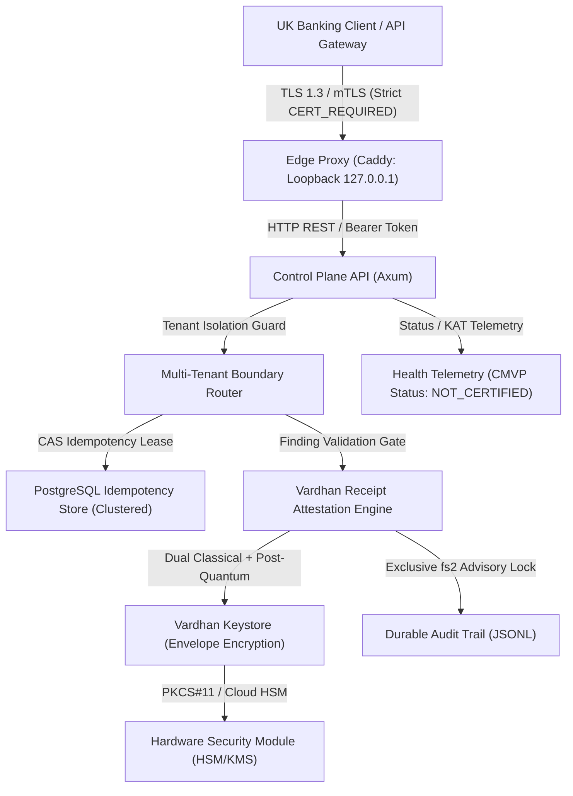

# UK Institutional Assurance Pack — Vardhan Q-Core

Status: **LOCAL POV VERIFIED | STAGING ACCEPTANCE VERIFIED | PRODUCTION BLOCKED (NOT APPROVED FOR LIVE RAILS)**  
Target Jurisdiction: **United Kingdom (Bank of England / PRA / FCA regulated perimeter)**  
Source Baseline: **ed5a81524d55ed153a9d5341350fdf36939cf0d9** (verified on `main`)

---

## 1. Executive Summary and UK Demarcation

This Assurance Pack compiles technical evidence, architecture models, security boundaries, and operational resilience metrics for UK banking institutions, clearing participants, and counterparty technical assurance teams evaluating **Vardhan Q-Core**.

### Institutional Boundaries and Non-Reliance Notice
- **Not Approved for Live Payment Rails**: Q-Core is verified for synthetic evaluation, integration sandboxing, and staging deployment. It is strictly blocked from connection to live payment rails (CHAPS, Faster Payments, BACS, SWIFT) until formal external certifications are evidenced.
- **Regulatory Demarcation**: Q-Core provides cryptographic attestation, durable idempotency, and post-quantum security mechanisms. It does **not** replace a regulated institution's authorization, AML/KYC, fraud monitoring, sanctions screening, regulatory reporting, or prudential settlement controls.
- **Zero Inferred Approval**: Green automated CI pipelines demonstrate passing unit, integration, and synthetic benchmark tests on pinned commits; they do not constitute formal regulatory approval or counterparty acceptance.

---

## 2. Institutional Architecture and Trust Boundaries

### Trust Boundary Definitions

1. **Ingress Boundary**:
   - Edge reverse proxy binds exclusively to loopback (`127.0.0.1`) by default (`${VARDHAN_BIND_IP:-127.0.0.1}`) across all published ports (80, 443, 8080, 5432, 3000), preventing accidental exposure to public interfaces.
   - Enforces TLS 1.3 termination with strict certificate verification (`CERT_REQUIRED`, `check_hostname=True`).
2. **Tenant Boundary**:
   - Organization identifiers are cryptographically bound to contract payloads (`DENY_ISSUER_UNBOUND`).
   - Cross-tenant data access returns HTTP 403/404; SCIM tokens are organization-bound.
3. **Execution & Idempotency Boundary**:
   - Clustered PostgreSQL employs atomic Compare-And-Swap (`INSERT ... ON CONFLICT DO NOTHING` and lease renewals), guaranteeing single-winner execution under concurrent identical requests.
   - Replay submissions are rejected with deterministic status `REJECTED_REPLAY`.
4. **Cryptographic Custody Boundary**:
   - Private key material is never persisted in plaintext. Release builds enforce hardware KMS/HSM envelope encryption.

---

## 3. Cryptographic Design and Candidate Protocol Status

- **Hybrid Post-Quantum Schemes**: Dual classical (Ed25519) and post-quantum (ML-DSA-87 / Dilithium5, ML-KEM-1024 / Kyber1024) signatures and key encapsulation.
- **AER-KEP-Q Protocol**: An engineered post-quantum authenticated key exchange candidate with AEAD frame protection (ChaCha20-Poly1305 / AES-256-GCM), directional sequence binding, and session-derived key separation.
- **FIPS 140-3 Module Telemetry**: Control-plane health endpoints report internal Known Answer Test (KAT) power-on self-test status (`crypto_self_tests: "OPERATIONAL"`), explicitly distinguishing it from formal NIST CMVP module validation (`fips_140_3_validation: "NOT_CERTIFIED"`, certificate: null).
- **Independent Cryptographic Audit Notice**: AER-KEP-Q has not yet undergone formal external academic peer-review or an accredited security reduction; independent cryptographic review (BLK-003) remains a required production blocker.

---

## 4. Operational Resilience and Measured Benchmarks

In alignment with UK Supervisory Statement SS1/21 (Operational Resilience) and DORA principles:

| Verification Drill | Dataset & Concurrency | Measured Metric | Demonstrated Resilience Invariant |
|---|---|---|---|
| **Representative Database Restore** | 20,100 entities (10,000 transactions, 100 accounts, 10,000 audit records; 12 MB) | **432 ms RTO** (46,527 records/sec) | 100% financial amount sum integrity verified (1,860,185,000 minor units); full B-tree index reconstruction verified into isolated database (`vardhan_rep_tgt`). |
| **Live Runtime Concurrency Drill** | 50 concurrent requests over verified TLS proxy | **32.69 ms total** (1,529.5 req/sec; p95 6.88 ms) | Zero rejected or dropped requests; strict hostname and test CA verification. |
| **High-Availability Raft Consensus** | 3-node cluster; network partitions, leader crash, churn | 14/14 failure tests pass | Zero split-brain (p8.4a); automatic leader re-election; no data corruption under bidirectional partitions (10x soak). |
| **Multi-Node Idempotency Contention** | Concurrent identical contract submissions across worker nodes | 100% single-winner election | Atomic lease acquisition; secondary attempts receive cached receipt or `REJECTED_REPLAY`. |
| **Audit Trail Concurrency** | Multi-process concurrent appending | 5/5 audit tests pass | Exclusive advisory file locking (`fs2`) prevents line interleaving; O(1) trailing chunk seek (`len - 8192`) prevents full-file scan degradation. |

---

## 5. Responsibility Demarcation Matrix (External Gate Alignment)

| Domain | Implemented in Q-Core Software | External Required Dependency / Partner | Status |
|---|---|---|---|
| **Institutional Trust (BLK-001)** | `InstitutionalKeyRegistry`, BIC binding, not-before/not-after checks | External UK bank PKI federation, root CA distribution, SWIFT BIC directory | External Blocker |
| **Hardware Custody (BLK-001)** | Envelope encryption, PKCS#11 / AWS KMS / GCP KMS / Vault drills | Target bank physical HSM (Thales payShield, Luna, AWS CloudHSM) | External Blocker |
| **Cryptographic Certification (BLK-002)** | Internal KATs, pairwise consistency (PCT), CRNGT | Formal NVLAP laboratory assessment and NIST CMVP certificate | External Blocker |
| **Protocol Assurance (BLK-003)** | AER-KEP-Q hybrid handshake, AEAD nonce framing, anti-tamper | Independent accredited security firm cryptographic review | External Blocker |
| **Payment Counterparty (BLK-004)** | `pacs.008` & `pacs.009` validation, ISO 4217 minor units, UETR | Authorised UK clearing sandbox (Bank of England CHAPS / Faster Payments / SWIFT) | External Blocker |
| **Ledger Reconciliation (BLK-005)** | CAS idempotency reservation, lease timeout handling | Core-banking ledger connector with automated two-phase settlement reconciliation | External Blocker |

---

## 6. Incident Response, BCP and Exit Strategy

1. **Cryptographic Exposure Detection**:
   - `core_crypto::exposure_detector` continuously monitors session parameters; detected compromises advance epoch state and quarantine affected keys.
2. **Key Rotation Runbook**:
   - Multi-version key rotation allows historical signature verification while immediately retiring deprecated signing keys.
3. **Rollback Monotonicity**:
   - Release versions enforce schema monotonicity; automated rollback floors prevent state reversion below verified database schema revisions.
4. **Data Portability and Exit**:
   - Core transactional records and audit trails are exported in standard JSONL / ISO 20022 XML formats, ensuring zero vendor lock-in for institutional participants.

---

## 7. Strategic Business Alignment

- **Bootstrapped UK-First Model**: Vardhan Technologies operates strictly on a bootstrapped financial structure with zero third-party equity dilution or external institutional debt.
- **Commercial Demarcation**:
  - Phase 1 (£15K Discovery): Architecture, security review, and requirement scoping.
  - Phase 2 (£60K Proof of Value): Controlled, isolated environment testing against synthetic workloads.
  - Phase 3 (£500K Production Engagement): Subject to completion of BLK-001 through BLK-005 and institutional counterparty sign-off.
- **Revenue Governance**: The £1.5B annual revenue ambition represents a long-term corporate target, not a near-term financial forecast. Licence, deployment, OEM, and usage revenue streams are accounted without double-counting.
