# Vardhan Technologies — Real-Time Architecture

> **BE DIFFERENT**

This document is the visual architecture reference for how Vardhan Technologies operates from intelligence discovery through governed security execution and independent proof.

## 1. System Mind Map

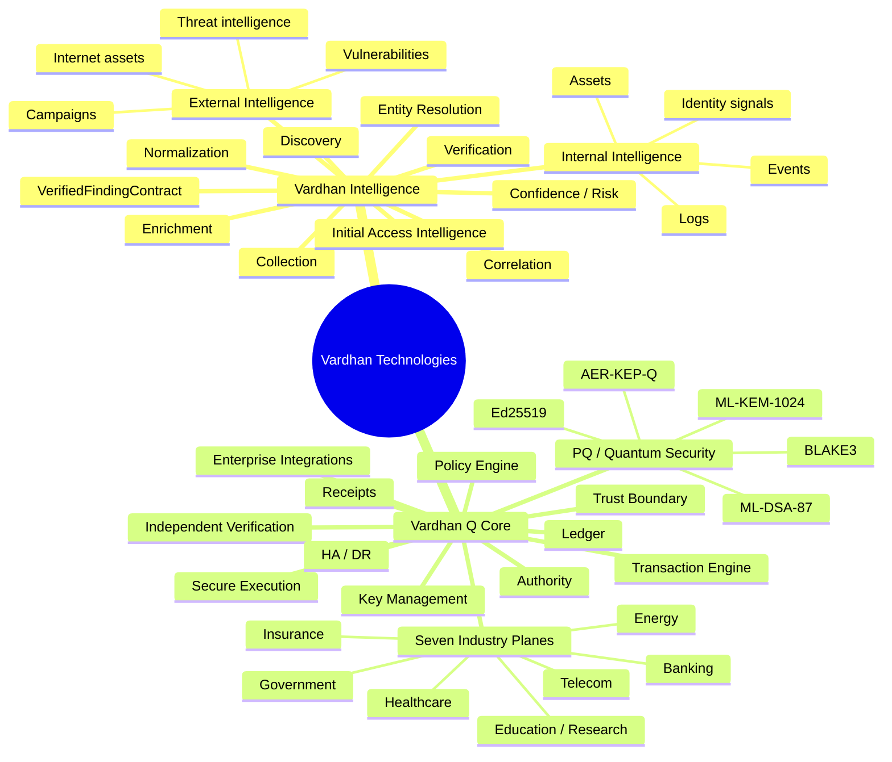

## 2. What Happens in Real Time

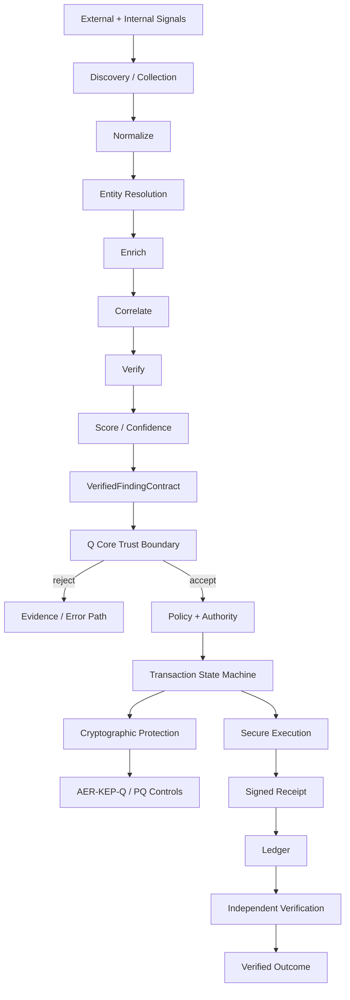

### The rule

**Intelligence can discover and recommend. Q Core decides what can be trusted and what can execute.**

The intelligence plane never bypasses the Q Core trust boundary.

## 3. Intelligence Pipeline

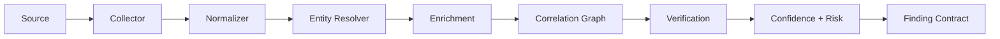

### Finding model

```text
Organization
   ↓
Internet / Internal Assets
   ↓
Technology / Identity / Exposure
   ↓
Vulnerability / Threat Activity
   ↓
Likely Initial Access / Entry Point
   ↓
Evidence
   ↓
Confidence
   ↓
Risk
   ↓
VerifiedFindingContract
```

## 4. Trust Boundary

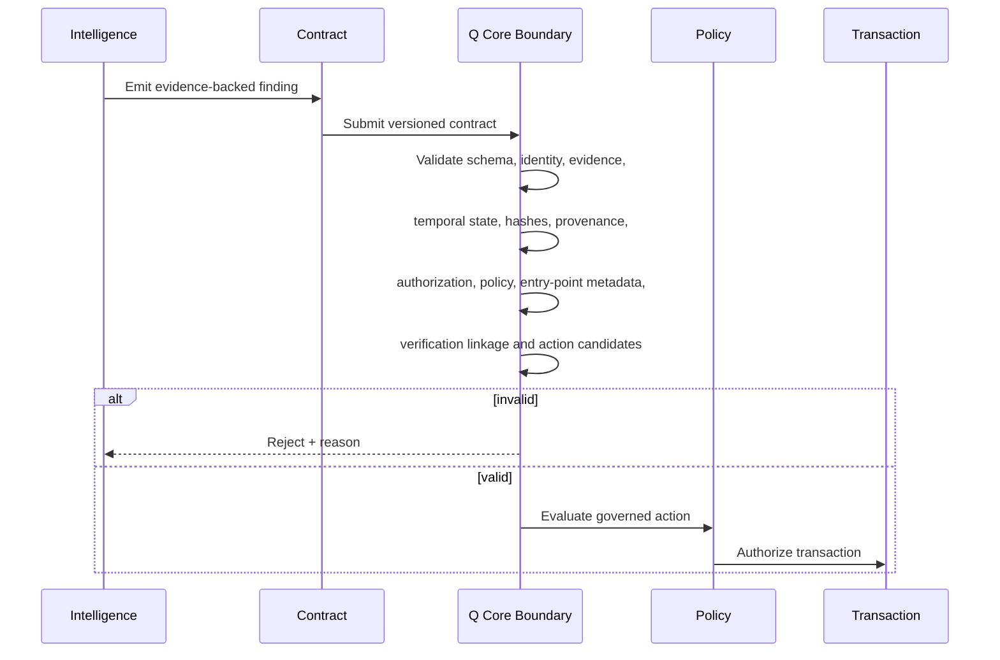

The current trust boundary is a canonical **22-check validation model**. Rust and TypeScript implementations must remain contract-compatible.

## 5. Q Core Transaction Lifecycle

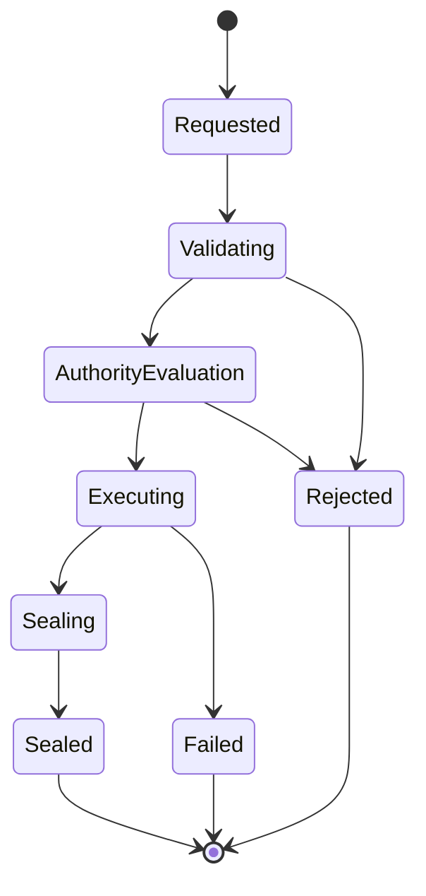

A transaction is not considered complete merely because an action ran. Q Core produces verifiable evidence of the governed transaction.

## 6. Cryptographic Control Plane

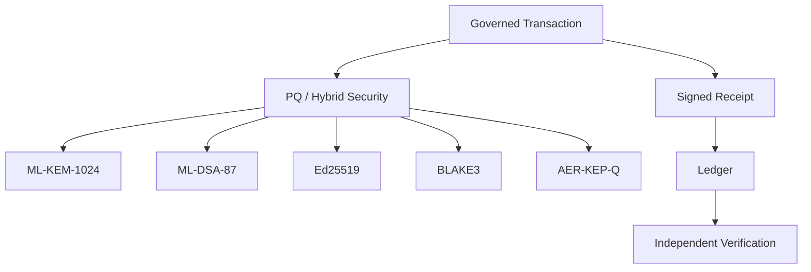

The existing receipt/governance signing path remains distinct from AER-KEP-Q. AER-KEP-Q provides confidential session key establishment and exposure-aware epoch lifecycle; it does not replace transaction authentication or governance.

## 7. AER-KEP-Q Runtime Recovery

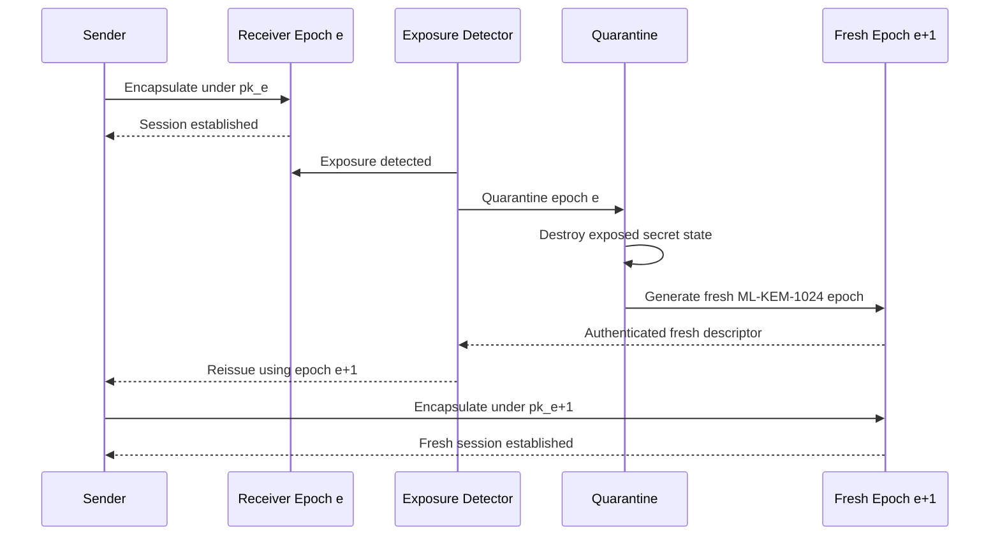

AER-KEP-Q does **not** retroactively recover ciphertexts whose complete decryption state was already exposed. Pending application payloads require retransmission/reissue under the fresh epoch.

## 8. Seven Industry Planes

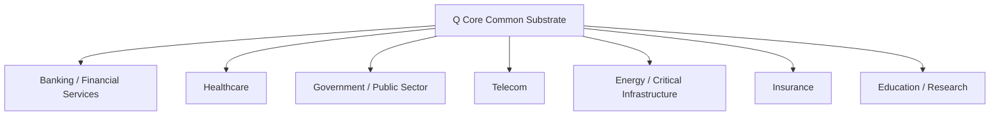

Each plane consumes the common trust, crypto, policy, transaction, evidence, and integration substrate while providing industry-specific assets, threat models, workflows, policies, risk models, control mappings, dashboards, integrations, reports, and deployment templates.

## 9. Production Deployment

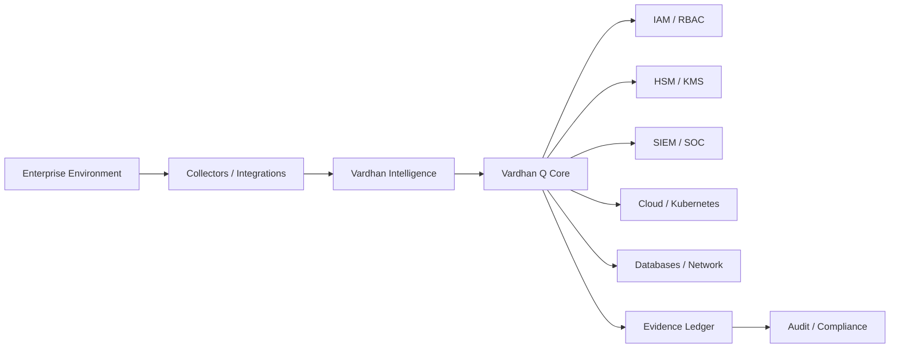

Production deployment must separately validate HSM/KMS custody, HA/DR, network topology, IAM, observability, backup/restore, failure behavior, and external assurance requirements.

## 10. Security Control Chain

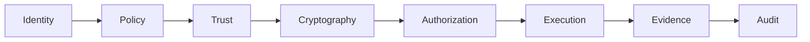

This chain is cross-cutting across both pillars. Security is not a separate third business pillar.

## 11. Production vs Simulation

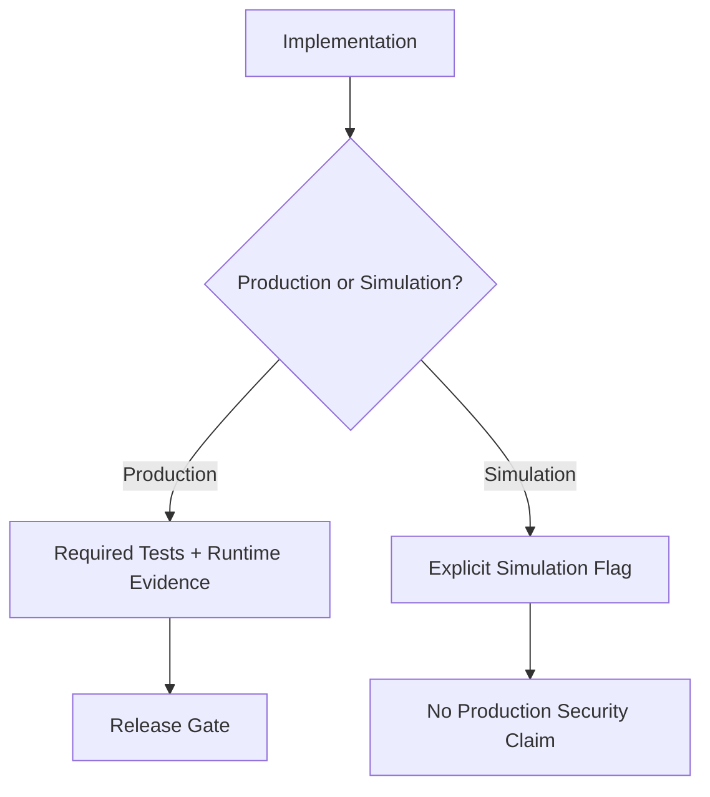

Simulation code must remain explicitly identified. A simulation is not evidence of production security.

## 12. Evidence Model

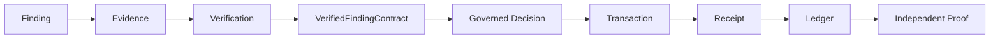

## 13. Failure / Recovery Model

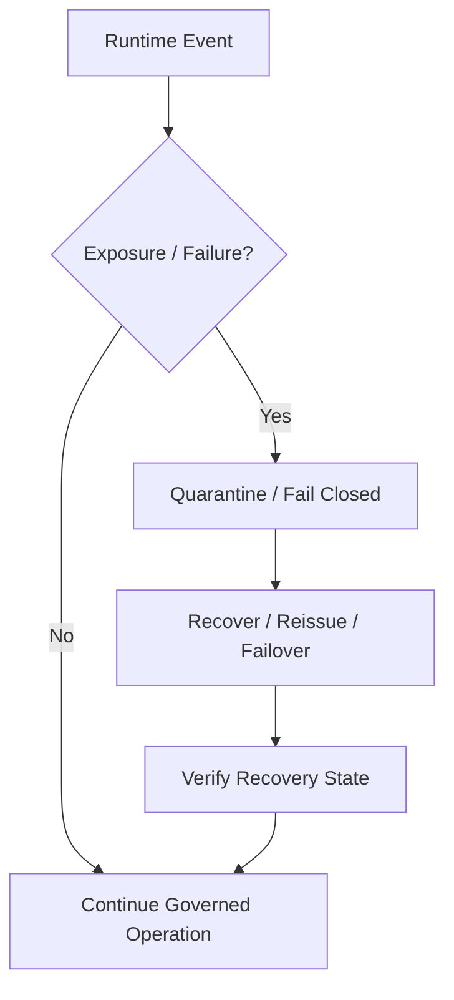

The system should prefer explicit failure and governed recovery over silent degradation.

## 14. Documentation Rule

The README is the short entry point. This document is the visual system reference. Detailed implementation, assurance, security findings, runtime state, and industry requirements remain in their dedicated documents.

When implementation changes, update the architecture diagram and the relevant contract/runtime documentation in the same change.
