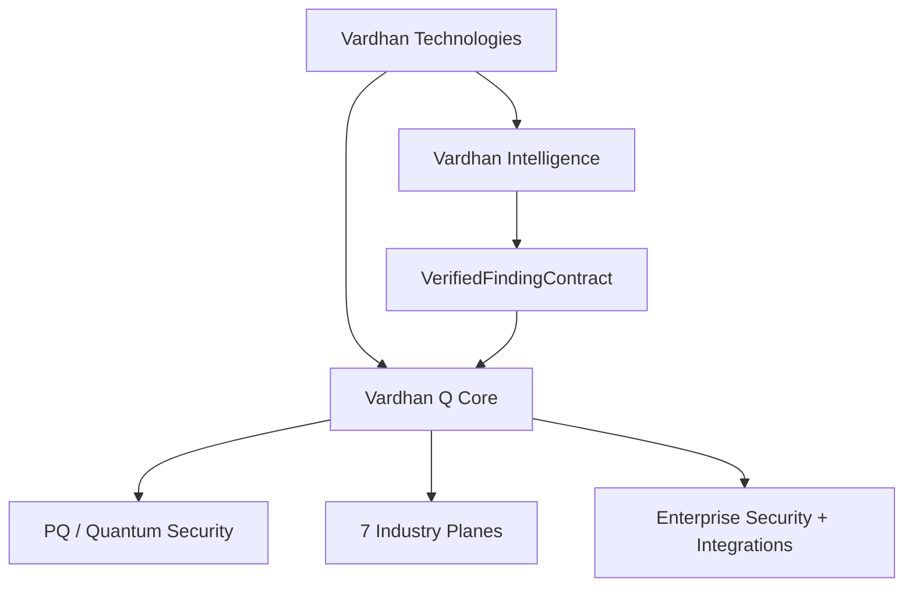
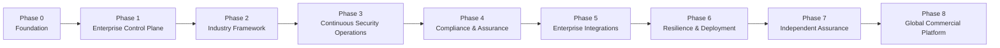
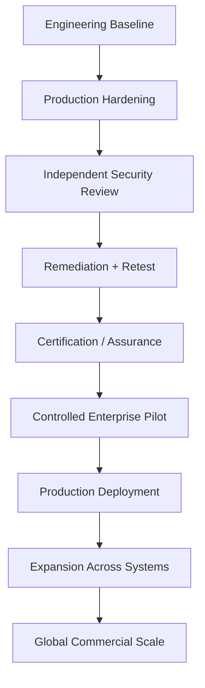

# Vardhan Technologies — Production Roadmap

> **BE DIFFERENT**

This is the current product and engineering roadmap. It replaces older repository-specific roadmap language that described a separate Quantum Proxy product.

## Product Model



## Phase Map



## Phase 0 — Foundation

**Status: Engineering baseline established**

- PQ cryptography
- ML-KEM / ML-DSA
- Trust boundary
- Authority / governance
- Transaction state machine
- Signed receipts
- Ledger + independent verification
- Intelligence → Q Core path
- AER-KEP-Q
- Exposure detection / quarantine / recovery
- Restart-safe runtime state
- Durable idempotency
- CI/build infrastructure

**Gate:** stable foundation for enterprise platform development.

## Phase 1 — Enterprise Control Plane

**Status: Engineering implemented; production hardening continues**

- Organizations / tenants
- Users / roles / RBAC
- Projects / environments
- Asset inventory
- Security policies
- Configuration
- Secrets / key-management interfaces
- Enterprise API
- Admin console
- Audit trail
- Notifications
- Health / status
- Entitlements / licensing

## Phase 2 — Industry Framework

**Status: Common architecture established; industry-depth execution continues**

Seven planes:

1. Banking / Financial Services
2. Healthcare
3. Government / Public Sector
4. Telecom
5. Energy / Critical Infrastructure
6. Insurance
7. Education / Research

Each plane must provide its own asset model, threat model, workflows, policies, risk model, compliance mappings, dashboards, integrations, reporting, and deployment templates while using the common Q Core substrate.

## Phase 3 — Continuous Security Operations

**Status: Engineering foundation established; production data/connectors continue**

- Continuous monitoring
- Exposure detection
- Risk scoring
- Security posture
- Policy drift
- Crypto posture
- Key lifecycle
- AER-KEP-Q operations
- Alerts
- Incident workflows
- Safe automated remediation
- Executive reporting

## Phase 4 — Compliance & Assurance Engineering

**Status: Engineering controls implemented; external assurance remains separate**

- Control mapping
- Audit evidence
- Immutable receipts
- Compliance dashboards
- Evidence export
- Security reports
- Vulnerability management
- SBOM
- Secure release evidence
- Incident records
- Access reviews
- Policy history

Target mappings include NIST CSF 2.0, PCI DSS, SOC 2, NIST SP 800-53, HIPAA, SOX, GDPR, and ISO 27001 as applicable. A mapping is not certification.

## Phase 5 — Enterprise Integrations

**Status: Integration architecture established; deployment-specific connectors continue**

- IAM
- SIEM / SOC
- Cloud
- Kubernetes
- Databases
- Network
- KMS / HSM
- ITSM
- Industry environments
- Security products

Goal: integrate into existing enterprise infrastructure rather than require customers to rebuild it.

## Phase 6 — Resilience & Enterprise Deployment

**Status: Engineering baseline established; real-world failure validation remains a gate**

- Multi-node HA
- Distributed idempotency
- Failover
- Disaster recovery
- Backup / restore
- HSM / KMS deployment
- Key rotation
- Multi-region
- Offline / isolated deployment where applicable
- Zero-downtime upgrades
- Rollback protection
- Real failure testing

## Phase 7 — Independent Security Assurance

**Status: External work / assurance gate**

Required work includes:

- Independent architecture review
- External penetration test
- Red-team assessment
- AER-KEP-Q cryptographic review
- Threat-model review
- Secure-code assessment
- Supply-chain assessment
- ISO 27001 program / certification as applicable
- SOC 2 readiness / attestation as applicable
- Customer assurance packages

**Important:** repository CI passing does not equal independent security assurance.

## Phase 8 — Global Commercial Platform

**Status: Future commercial execution**

- Global enterprise sales
- Strategic bank pilots
- Sector specialists
- Government / regulated-market programs
- Integrators and channel partners
- Production expansion
- Multi-country deployment
- Annual recurring platform contracts
- Industry-specific expansion

The commercial strategy is **pilot → production → annual platform revenue → expansion**.

## Dependency / Gate Model



## What Is Already Different

The platform is not positioned as a list of cryptographic algorithms. The differentiated system is the integration of:

```text
Intelligence
   ↓
Evidence
   ↓
Independent Verification
   ↓
Trust Boundary
   ↓
Policy / Authority
   ↓
Secure Transaction
   ↓
PQ / Cryptographic Protection
   ↓
Signed Evidence
   ↓
Ledger
   ↓
Independent Proof
```

## Production Gate

The repository should not be described as fully production-ready merely because compilation succeeds. The production gate requires:

- green CI for the relevant commit
- runtime/integration evidence
- supply-chain verification
- deployment-specific security configuration
- HSM/KMS controls where required
- resilience/failure testing
- independent security assessment
- remediation and independent retest
- applicable certification/assurance completion

## Source of Truth

- `README.md` — concise platform entry point
- `docs/VARDHAN_ARCHITECTURE_REALTIME.md` — visual architecture and runtime behavior
- `docs/BACKEND_ARCHITECTURE_AUDIT.md` — backend architecture and technical boundaries
- `runtime/` — current runtime status, tests, errors, and reports
- this file — current product roadmap and gates
