# Vardhan Technologies — Production Roadmap

> **BE DIFFERENT**

This is the current product, engineering, assurance and commercialization roadmap. It is organized around the two-pillar platform and uses explicit production gates rather than treating documentation or feature completion as production readiness.

## 01 — Platform Mind Map

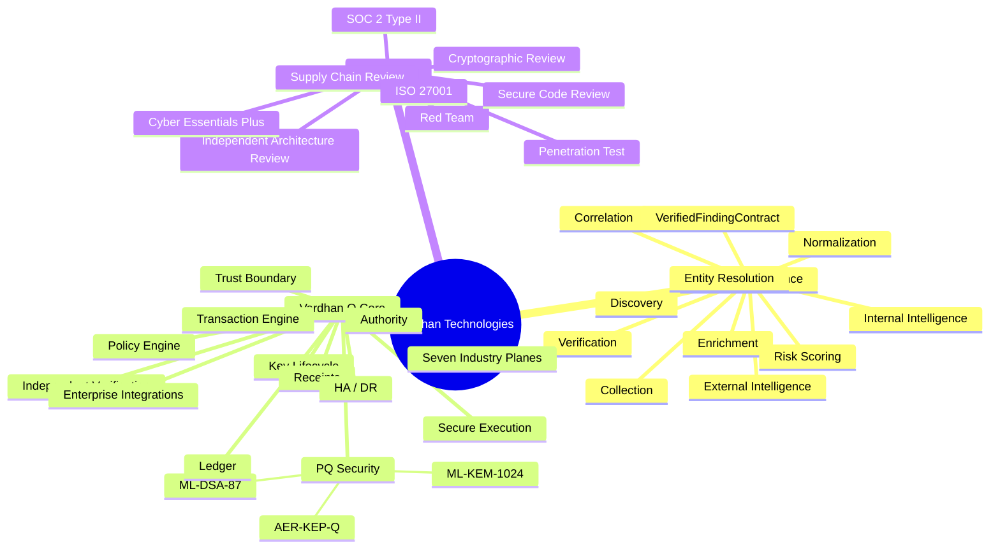

## 02 — How the Platform Operates


**Core principle:** Intelligence produces evidence-backed findings. Q Core independently validates, governs, protects, executes and proves the resulting action.

## 03 — Roadmap at a Glance

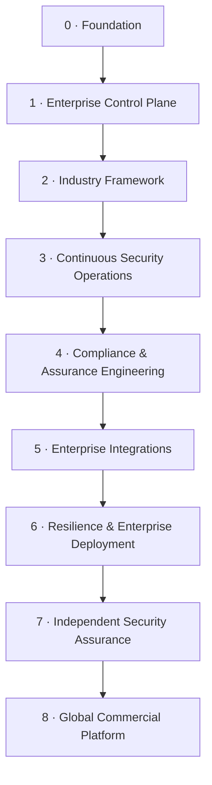

---

## Phase 0 — Foundation

**Status: Engineering baseline established**

- PQ cryptography: ML-KEM / ML-DSA
- Trust boundary
- Authority / governance
- Transaction state machine
- Signed receipts
- Ledger + independent verification
- Intelligence → Q Core path
- AER-KEP-Q
- Exposure detection / quarantine / recovery
- Restart-safe runtime state
- Durable idempotency
- CI / build infrastructure

**Gate:** stable foundation for enterprise platform hardening.

## Phase 1 — Enterprise Control Plane

**Status: Engineering implemented; production hardening continues**

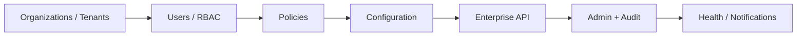

Scope:
- organizations / tenants
- users / roles / RBAC
- projects / environments
- asset inventory
- security policies
- configuration
- secrets / key-management interfaces
- enterprise API
- admin console
- audit trail
- notifications
- health / status
- entitlements / licensing

## Phase 2 — Seven Industry Framework

**Status: Common architecture established; industry-depth execution continues**

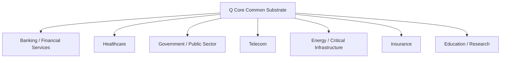

Each plane must provide:
- industry asset model
- threat model
- security workflows
- policies
- risk model
- compliance/control mappings
- dashboards
- integrations
- reporting
- deployment templates

The seven planes share the same trust, cryptographic, governance, transaction, evidence and integration substrate.

## Phase 3 — Continuous Security Operations

**Status: Engineering foundation established; production data/connectors continue**

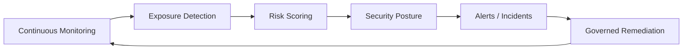

Scope:
- continuous monitoring
- exposure detection
- risk scoring
- security posture
- policy drift
- crypto posture
- key lifecycle
- AER-KEP-Q operations
- alerts
- incident workflows
- safe automated remediation
- executive reporting

## Phase 4 — Compliance & Assurance Engineering

**Status: Engineering controls implemented; external assurance remains separate**

- control mapping
- audit evidence
- immutable receipts
- compliance dashboards
- evidence export
- security reports
- vulnerability management
- SBOM
- secure release evidence
- incident records
- access reviews
- policy history

Target mappings include NIST CSF 2.0, PCI DSS, SOC 2, NIST SP 800-53, HIPAA, SOX, GDPR and ISO 27001 as applicable. **A mapping is not a certification.**

## Phase 5 — Enterprise Integrations

**Status: Integration architecture established; deployment-specific connectors continue**

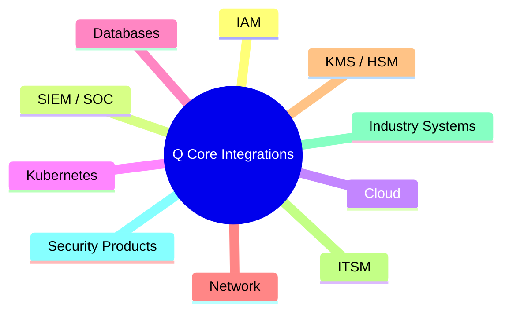

Goal: integrate into existing enterprise infrastructure rather than require customers to rebuild it.

## Phase 6 — Resilience & Enterprise Deployment

**Status: Engineering baseline established; real-world failure validation remains a gate**

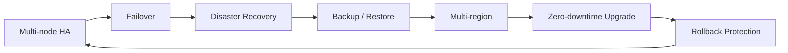

Scope:
- multi-node HA
- distributed idempotency
- failover
- disaster recovery
- backup / restore
- HSM / KMS deployment
- key rotation
- multi-region
- offline / isolated deployment where applicable
- zero-downtime upgrades
- rollback protection
- real failure testing

---

# Phase 7 — Independent Security Assurance

**Status: External assurance gate**

## Assurance Stack

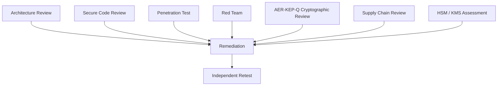

## Certification & Assurance Badges

> **These are roadmap targets, not certifications currently held.** A badge becomes an official claim only after the corresponding certificate, attestation or independent assessment is actually issued.

| Roadmap target | What it demonstrates | Gate |
|---|---|---|
|  | UK baseline cyber controls | Readiness + certification |
|  | Independently tested baseline controls | External technical assessment |
|  | Information security management system | Certification audit |
|  | Operating effectiveness of security controls | Type II observation period + attestation |
|  | Payment-card security where applicable | Applicable-scope assessment |
|  | Control framework alignment | Evidence-backed mapping |
|  | External technical attack validation | Pentest + remediation + retest |
|  | Adversarial end-to-end validation | Red-team exercise + remediation |
|  | Independent cryptographic assessment | AER-KEP-Q + crypto architecture review |
|  | Production key-custody assurance | Deployment assessment |

### Assurance sequence

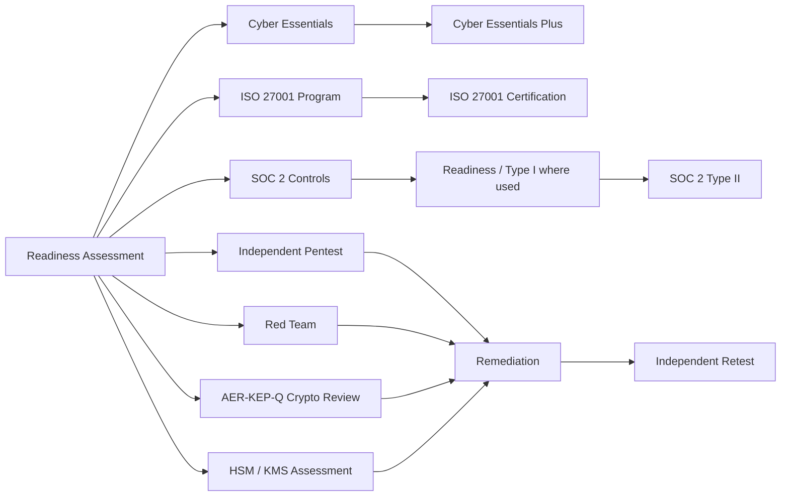

Required external work includes:
- independent architecture review
- external penetration test
- red-team assessment
- AER-KEP-Q cryptographic review
- threat-model review
- secure-code assessment
- supply-chain assessment
- ISO 27001 program / certification as applicable
- SOC 2 readiness / Type II attestation as applicable
- Cyber Essentials / Cyber Essentials Plus as applicable to UK operations
- customer-specific assurance packages

These assurance tracks overlap but are **not substitutes for one another**. Certification does not by itself prove that every customer deployment is secure.

---

# Phase 8 — Global Commercial Platform

**Status: Future commercial execution**

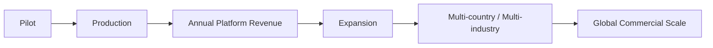

Scope:
- global enterprise sales
- strategic bank pilots
- sector specialists
- government / regulated-market programs
- integrators and channel partners
- production expansion
- multi-country deployment
- annual recurring platform contracts
- industry-specific expansion

---

## Production Gate — Non-Negotiable

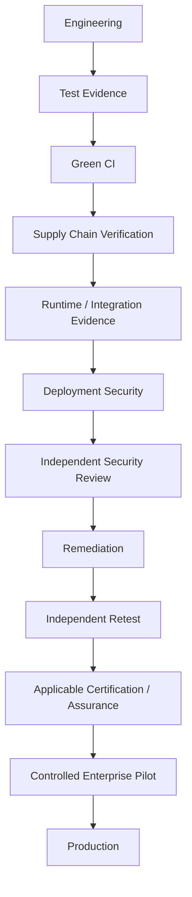

The platform must **not** be described as fully production-ready merely because compilation succeeds.

Production gate requires, as applicable:

- green CI for the exact release commit
- runtime/integration evidence
- supply-chain verification
- deployment-specific security configuration
- HSM/KMS controls where required
- resilience/failure testing
- independent security assessment
- remediation and independent retest
- applicable certification / assurance completion

## What Is Already Different

```text
Intelligence
   ↓
Evidence
   ↓
VerifiedFindingContract
   ↓
Independent Trust Validation
   ↓
Policy / Authority
   ↓
Secure Transaction
   ↓
PQ / Cryptographic Protection
   ↓
Signed Evidence
   ↓
Ledger
   ↓
Independent Proof
```

The differentiation is the integrated control path—not a claim of a new cryptographic primitive.

## Source of Truth

- `README.md` — concise platform entry point and visual overview
- `docs/VARDHAN_ARCHITECTURE_REALTIME.md` — visual architecture and runtime behavior
- `docs/BACKEND_ARCHITECTURE_AUDIT.md` — backend architecture and technical boundaries
- `runtime/` — current runtime status, tests, errors and reports
- this file — current product roadmap, assurance roadmap and production gates
