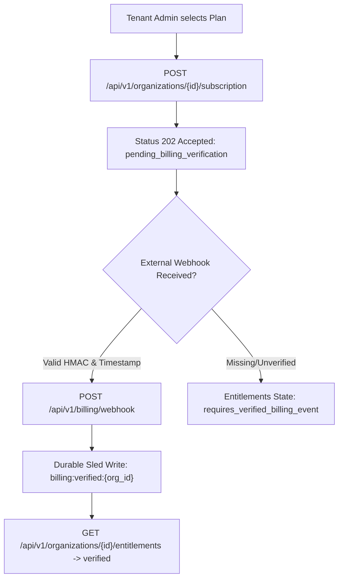

# Enterprise Billing, Entitlements & Metering Architecture — Mission J

**Authoritative Specification of Commercial Catalog, Entitlement Enforcement & Webhook Security**  
**Date:** 2026-10-18  
**Repository:** `https://github.com/vishnuvardhanburri/VARDHAN_Q_CORE-PLATFORM`  
**Backend Source:** `backend/control_plane_api/src/lib.rs`, `backend/control_plane_api/src/billing_api.rs`  
**Frontend Source:** `intelligence_plane/src/console/BillingView.tsx`, `intelligence_plane/src/services/qcore.ts`

---

## 1. The Authoritative Six-Plan Catalog

The Vardhan Q-Core platform enforces an authoritative backend catalog exposed via `GET /api/v1/catalog/plans`. The frontend console never invents or hardcodes tier definitions or pricing.

| # | Plan Identifier | Plan Name | Price | Billing Model | Tier Category | Contact Sales | Authoritative Entitlements Granted | Commercial Profile |
|---|---|---|---|---|---|---|---|---|
| 1 | `qcore_architecture_evaluation` | Architecture & Security Evaluation | £15,000 fixed fee | `fixed_fee` | `professional_service` | `true` | `q_core_evaluation` | Fixed-scope architecture review, cryptographic readiness audit. |
| 2 | `qcore_proof_of_value` | Bounded Proof of Value | £60,000 fixed fee | `fixed_fee` | `professional_service` | `true` | `q_core_pov` | Time-boxed 30-day PoV deployment, dual-signature evaluation. |
| 3 | `foundation` | Foundation | £360,000 / year | `annual_license` | `enterprise` | `true` | `q_core`, `audit`, `api` | Production single-tenant receipt signing and local verification. |
| 4 | `enterprise` | Enterprise | £720,000 / year | `annual_license` | `enterprise_plus` | `true` | `q_core`, `audit`, `api`, `rbac`, `integrations`, `compliance`, `usage` | Multi-user enterprise control plane with SCIM, WebAuthn MFA, and usage telemetry. |
| 5 | `advanced_resilience` | Advanced Resilience | £1,200,000 / year | `annual_license` | `advanced_resilience` | `true` | `q_core`, `audit`, `api`, `rbac`, `integrations`, `compliance`, `usage`, `aer_kep_q`, `ha`, `dr`, `hsm_kms` | Adds key epoch transitions (`aer_kep_q`), HA clustering (experimental Raft), and HSM key custody hooks. |
| 6 | `strategic` | Strategic / Sovereign | Bespoke (£12,000,000 baseline target, £5M–£50M scoped) | `scoped` | `strategic` | `true` | `q_core`, `audit`, `api`, `rbac`, `integrations`, `compliance`, `usage`, `aer_kep_q`, `ha`, `dr`, `hsm_kms`, `sovereign_deployment`, `air_gapped`, `dedicated_assurance` | Defense-grade air-gapped and sovereign enclave deployments with offline verifier and dedicated assurance. |

*Pricing Structure & Billing Classification:*
- Fixed fees: Discovery (£15,000) and PoV (£60,000) are one-off evaluation engagements (`one_off`).
- Annual licences: Foundation (£360,000/yr), Enterprise (£720,000/yr), and Advanced Resilience (£1,200,000/yr) are recurring annual subscriptions (`annual`).
- Scoped engagement: Strategic / Sovereign (Bespoke / £12M target) is individually scoped for sovereign/air-gapped environments (`custom`).

> [!IMPORTANT]
> **Commercial Progression:** Software licensing tiers progress monotonically in capability and pricing: Foundation (£360K/yr) for single-tenant validation, Enterprise (£720K/yr) for organization-wide governance and compliance, Advanced Resilience (£1.2M/yr) for critical post-quantum key transitions and active-active clustering, and Strategic / Sovereign (£12M baseline target) for air-gapped defense enclaves. Plan identifiers and entitlements are preserved without inventing artificial capabilities.

---

## 2. Subscription State & Activation Machine

Subscription records and entitlement activations are strictly decoupled to prevent authorization bypasses. Merely creating a subscription record does NOT activate capabilities.

### A. Lifecycle States (`SubscriptionState`)
Backend definition in `backend/control_plane_api/src/billing.rs`:
1. `Active`: Entitlements enabled (`allows_entitlements() == true`).
2. `Trialing`: Entitlements enabled (`allows_entitlements() == true`).
3. `PastDue`: Entitlements temporarily suspended (`allows_entitlements() == false`).
4. `Canceled`: Entitlements terminated (`allows_entitlements() == false`).
5. `Unpaid`: Entitlements suspended (`allows_entitlements() == false`).
6. `Incomplete`: Awaiting initial payment (`allows_entitlements() == false`).
7. `IncompleteExpired`: Abandoned order (`allows_entitlements() == false`).

### B. Activation Verification Flow


When an organization is initialized, `GET /api/v1/organizations/{id}/entitlements` evaluates `b"billing:verified:"`. If absent:
```json
{
  "organization_id": "org_xxx",
  "subscription_status": "unverified",
  "entitlements": [],
  "activation": "requires_verified_billing_event"
}
```
Only after an authoritative billing webhook arrives with valid HMAC signatures does the state machine transition to `activation: "verified"` and unlock feature execution.

---

## 3. Metering & Billing Webhook Security

The control plane implements strict cryptographic webhook verification at `POST /api/v1/billing/webhook`.

### A. Header Specifications
- `x-vardhan-billing-signature`: Hex-encoded HMAC-SHA256 of the raw request payload computed using `VARDHAN_BILLING_WEBHOOK_SECRET`.
- `x-vardhan-billing-timestamp`: Unix epoch seconds timestamp.

### B. Anti-Replay Verification
```rust
pub fn verify_timestamp(event_ts: u64, now: u64) -> bool {
    let skew_limit = 300; // 5 minutes
    now.saturating_sub(skew_limit) <= event_ts && event_ts <= now.saturating_add(skew_limit)
}
```
Any webhook with a timestamp older than 300 seconds (or more than 300 seconds in the future) is rejected immediately with HTTP 401 Unauthorized.

### C. Atomic Idempotency Storage
Every incoming webhook event is keyed by its unique `event_id`:
- Sled key: `b"billing:event:<event_id>"`
- Before executing state changes, the control plane checks `state.db.contains_key()`. If present, the duplicate is dropped idempotently with HTTP 200 without double-crediting usage or repeating transitions.

### D. Usage Metering Dimension
The control plane tracks multi-dimensional SaaS consumption at `POST /api/v1/organizations/{id}/usage/record`:
- `transactions`: Counter of executed transaction receipts (64-bit saturating add).
- `bytes_processed`: Counter of payload throughput (64-bit saturating add).
- Storage key: `b"usage:<organization_id>"`.
- Authorization: Restricted to internal pipeline callers holding the `usage-write` permission.

---

## 4. Frontend Console Integration (`BillingView.tsx`)

1. **Plan Catalog Grid:** Renders all 6 plans side-by-side with full badge hierarchy, included features, and "Upgrade / Switch Plan" interactive actions.
2. **Subscription Card:** Highlights active plan ID, provider (`stripe` / `sovereign_license`), external customer ID, and verification status pill (`VERIFIED` in emerald vs `PENDING VERIFICATION` in amber).
3. **Verified Entitlements Checklist:** Dynamically queries `/api/v1/organizations/{id}/entitlements` and renders real-time authorization state for features including:
   - `q_core` (Canonical Receipt Signing)
   - `audit` (Immutable Hash Chain Ledger)
   - `aer_kep_q` (Post-Quantum Key Epoch Transitions)
   - `hsm_kms` (Hardware Key Custody)
   - `air_gapped` (Offline Enclave Verification)
4. **Metered Consumption Strip:** Real-time counters showing total transactions and KB/MB processed.
