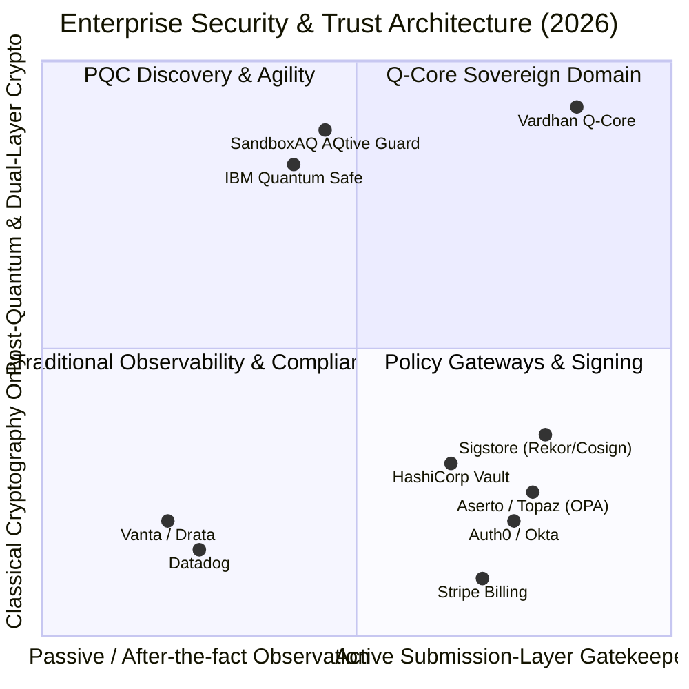

# Comprehensive Competitive Market Map & Architecture Analysis

**Document ID:** `docs/mission-j/COMPETITIVE_MARKET_MAP.md`  
**Classification:** Product Intelligence & Technical Competitor Mapping  
**Date:** 2026-10-18  
**Scope:** Direct & Adjacent Alternatives to Vardhan Q-Core Enterprise Platform  

---

## 1. Market Overview & Taxonomy

Vardhan Q-Core addresses a distinct architectural intersection: **submission-layer trust, transaction-time policy enforcement, and cryptographically verifiable dual-signature receipts (ML-DSA-87 + Ed25519)** with post-quantum agility.

To evaluate Q-Core's position, we analyze 10 leading enterprise platforms across four market quadrants:

---

## 2. Capability Evaluation Matrix

**Capability Legend:**  
- **VERIFIED:** Explicitly documented in vendor documentation, CLI, or API reference.  
- **PARTIAL:** Supported via custom plugins, external tooling, or preview tier.  
- **NOT_FOUND:** Not found in reviewed authoritative documentation.  
- **N/A:** Outside product domain.  
- **UNKNOWN:** Proprietary / unverified pricing or private capability.  

| Capability Dimension | Vardhan Q-Core | OPA / Aserto (Topaz) | Sigstore (Cosign / Rekor) | HashiCorp Vault | SandboxAQ (AQtive Guard) | Vanta / Drata | Datadog |
| :--- | :---: | :---: | :---: | :---: | :---: | :---: | :---: |
| **Submission-Time Policy Enforcement** | **VERIFIED** | **VERIFIED** | PARTIAL (Admission) | PARTIAL (Sentinel) | NOT_FOUND | NOT_FOUND | NOT_FOUND |
| **Dual Classical + PQ Signatures** | **VERIFIED** (ML-DSA-87 + Ed25519) | NOT_FOUND | PARTIAL (Experimental) | PARTIAL (External HSM) | **VERIFIED** (Discovery) | N/A | N/A |
| **Pre-Execution Idempotency Guard** | **VERIFIED** (Sled Atomic) | NOT_FOUND | NOT_FOUND | **VERIFIED** (Tokens) | N/A | N/A | N/A |
| **Self-Verifying Receipts** | **VERIFIED** (Offline Tool) | NOT_FOUND | **VERIFIED** (Rekor Bundle) | PARTIAL (Audit Log) | NOT_FOUND | NOT_FOUND | NOT_FOUND |
| **Tenant-Bound Isolation** | **VERIFIED** (URL-Payload Guard) | **VERIFIED** (Zanzibar ReBAC) | PARTIAL (OIDC Claims) | **VERIFIED** (Namespaces) | **VERIFIED** | **VERIFIED** | **VERIFIED** |
| **Time-Filtered Activity Stream** | **VERIFIED** (24H/7D/30D/All) | PARTIAL | **VERIFIED** (Log Query) | **VERIFIED** (Syslog) | **VERIFIED** | **VERIFIED** | **VERIFIED** |
| **6-Plan Enterprise Catalog & Usage Metering** | **VERIFIED** (SaaS Metering) | N/A | N/A | N/A | N/A | N/A | **VERIFIED** (Telemetry Billing) |
| **SCIM v2.0 / WebAuthn / SSO** | **VERIFIED** (Rust native) | PARTIAL (Aserto Directory) | PARTIAL (OIDC Fulcio) | **VERIFIED** | PARTIAL | **VERIFIED** | **VERIFIED** |

---

## 3. Deep Competitor Profiles

### 1. Aserto / Topaz (Open Policy Agent + Google Zanzibar)
- **Product & Vendor:** Topaz by Aserto (Open Source + Cloud SaaS).
- **Category:** Cloud-Native Authorization Engine (ABAC + ReBAC).
- **Target Buyer:** Application security leads, engineering directors.
- **Problem Solved:** Fine-grained authorization decisions decoupled from application logic.
- **Deployment Model:** Sidecar microservice in Kubernetes or standalone Docker container.
- **Core Workflow:** Applications query `is_allowed(user, action, resource)` over gRPC/REST; Topaz computes decision using Rego policies and Zanzibar object graph.
- **Cryptographic & PQC Capabilities:** NOT_FOUND. Evaluates identity claims; does not sign transactions or issue cryptographic dual-layer receipts.
- **Replay & Idempotency:** NOT_FOUND. Stateless decision engine; caller must enforce replay protection.
- **Overlap with Q-Core:** Direct overlap in policy evaluation syntax and RBAC/ReBAC context.
- **Key Differentiation vs. Q-Core:** Topaz makes admission decisions but does not generate proof-carrying cryptographic receipts; Q-Core seals transactions with post-quantum digital signatures (ML-DSA-87) creating non-repudiable offline-verifiable audit bundles.
- **Source Citation:** https://github.com/aserto-dev/topaz, https://docs.aserto.com/docs/overview/authorizer (Accessed: 2026-10-18).

---

### 2. Sigstore (Cosign, Rekor, Fulcio)
- **Product & Vendor:** Sigstore (OpenSSF / Linux Foundation).
- **Category:** Software Supply Chain Signing & Transparency Ledger.
- **Target Buyer:** DevSecOps architects, platform engineers.
- **Problem Solved:** Keyless code signing, container image provenance, and verifiable public transparency logs.
- **Core Workflow:** Developer logs in via OIDC -> Fulcio issues short-lived X.509 cert -> Cosign signs artifact -> Signature and inclusion proof recorded in Rekor public transparency log.
- **Cryptographic & PQC Capabilities:** Classical ECDSA P-256 / Ed25519; experimental post-quantum pull requests in development; does not natively dual-sign production artifacts with ML-DSA-87.
- **Auditability & Exports:** **VERIFIED** (Rekor cryptographic inclusion proof bundles verifiable offline).
- **Overlap with Q-Core:** Direct overlap in offline-verifiable cryptographic receipts.
- **Key Differentiation vs. Q-Core:** Sigstore focuses on container images and software artifacts with a public transparency log; Q-Core is designed for enterprise transactions, banking data, API execution gates, and private tenant-isolated control planes.
- **Source Citation:** https://docs.sigstore.dev/logging/overview/, https://github.com/sigstore/rekor (Accessed: 2026-10-18).

---

### 3. SandboxAQ (AQtive Guard)
- **Product & Vendor:** AQtive Guard by SandboxAQ.
- **Category:** Cryptographic Inventory Management & Post-Quantum Readiness.
- **Target Buyer:** Chief Information Security Officers (CISO), Enterprise Cryptographers, Defense Agencies.
- **Problem Solved:** Discovers classical cryptography (RSA, ECC), simulates post-quantum migration blast radius, and monitors non-human identities.
- **Core Workflow:** Agents inspect networks and codebases -> Catalog cryptographic objects -> Map regulatory compliance (NIST SP 800-208, CNSA 2.0) -> Recommend PQC migration priority.
- **Cryptographic Capabilities:** **VERIFIED** PQC assessment and algorithm replacement simulation (Kyber/ML-KEM, Dilithium/ML-DSA).
- **Overlap with Q-Core:** Direct overlap in quantum-readiness vocabulary, algorithm migration, and crypto posture monitoring.
- **Key Differentiation vs. Q-Core:** SandboxAQ is an observational scanner and migration simulator; Q-Core is the **active execution gateway** that actually issues live hybrid post-quantum signed receipts on live transactions.
- **Source Citation:** https://www.aqtiveguard.com/platform, https://docs.aqtiveguard.com/ (Accessed: 2026-10-18).

---

### 4. HashiCorp Vault
- **Product & Vendor:** HashiCorp Vault (IBM).
- **Category:** Secrets Management, Key Management (KMS), and Data Encryption.
- **Target Buyer:** Infrastructure security engineers, platform operators.
- **Problem Solved:** Dynamic secret brokering, transit encryption, and centralized PKI.
- **Core Workflow:** Application authenticates via token/AppRole -> Vault evaluates ACLs -> Returns temporary credential or encrypts payload in transit.
- **Replay & Idempotency:** **VERIFIED** (Short-lived tokens, leasing engine, rate limits).
- **Overlap with Q-Core:** Overlap in enterprise keystore management and cryptographic operations.
- **Key Differentiation vs. Q-Core:** Vault acts as a safe for keys and secrets; Q-Core acts as a transaction enforcement boundary that binds tenant context, evaluates policies, seals receipts, and enforces continuous compliance.
- **Source Citation:** https://developer.hashicorp.com/vault/docs (Accessed: 2026-10-18).

---

### 5. Vanta / Drata
- **Product & Vendor:** Vanta / Drata.
- **Category:** Continuous Compliance Automation & Trust Centers.
- **Target Buyer:** Security & compliance leads, GRC managers.
- **Problem Solved:** Automated evidence gathering for SOC 2, ISO 27001, DORA, and FedRAMP.
- **Core Workflow:** Ingests state from AWS, GitHub, Okta via 400+ API connectors -> Runs hourly compliance checks -> Produces auditor evidence packs.
- **Cryptographic Verification:** NOT_FOUND. Collects API metadata and timestamps; does not verify cryptographic mathematical proofs or dual signatures.
- **Overlap with Q-Core:** Direct overlap in executive compliance reporting, auditor exports, and continuous operations monitoring.
- **Key Differentiation vs. Q-Core:** Vanta monitors infrastructure settings asynchronously; Q-Core creates tamper-evident, cryptographically sealed transaction proofs at the runtime execution point.
- **Source Citation:** https://www.vanta.com/resources/automated-evidence-collection-for-compliance-all-you-need-to-know (Accessed: 2026-10-18).

---

### 6. Stripe Billing / Metronome / Orb
- **Product & Vendor:** Stripe Billing.
- **Category:** Usage Metering, Subscription Management, and Entitlements.
- **Target Buyer:** Product managers, revenue operations, finance leads.
- **Problem Solved:** Recurring billing, tiered usage calculation, and customer entitlement provisioning.
- **Core Workflow:** Application emits usage events (`record_usage`) -> Metering engine aggregates units -> Invoices generated on billing cycles.
- **Relevance to Q-Core:** Q-Core's `billing.rs` and `saas_metering` implement the exact Stripe webhook contract and 6-plan subscription structure. Mission J elevates these backend capabilities into the visible console.
- **Source Citation:** https://stripe.com/docs/billing (Accessed: 2026-10-18).

---

## 4. Synthesis: High-Value Capabilities to Adopt in Q-Core

From this competitive analysis, the following capabilities are prioritized for Q-Core console adoption:

1. **Stripe/Datadog-Style Live Console UX:**
   - Unified time-range filtering (24H, 7D, 30D, ALL).
   - Clear KPI cards with defined source attribution.
   - Live activity stream with entity drill-down.
2. **Sigstore-Style Verification Inspection:**
   - Dedicated receipt verification viewer displaying both classical (Ed25519) and post-quantum (ML-DSA-87) signatures with fingerprint details.
3. **Stripe/Metronome-Style Billing & Entitlement Visibility:**
   - Clean visualization of the 6-plan catalog, active subscription status, feature entitlements, and metered usage.
4. **Vanta/Drata-Style Evidence Packaging:**
   - Auditor-ready compliance exports linking verified findings to durable cryptographic receipts.
