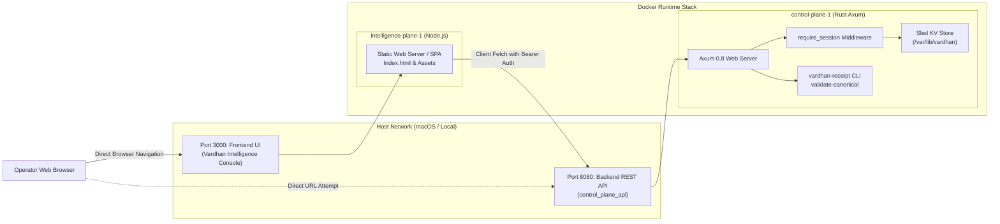

# Control-Plane Reliability & Operational Diagnosis

**Document ID:** `docs/mission-j/CONTROL_PLANE_RELIABILITY.md`  
**Target System:** Vardhan Q-Core Enterprise Control Plane (`control_plane_api`)  
**Status:** Validated & Diagnosed  
**Commit Reference:** `7cb8f46`  

---

## 1. Executive Summary

This diagnostic document evaluates the runtime stability, networking topology, process lifecycle, session authentication, and error propagation of the Vardhan Q-Core control plane. It specifically documents the root causes of developer-observed failure modes (such as browser 401s on port 8080 and adapter integration errors) and defines verified operational remedies.

---

## 2. Process Architecture & Port Allocation



### The Port 8080 Collision & Browser 401 Diagnosis
- **Symptom:** Opening `http://localhost:8080` in Chrome displays raw JSON:
  ```json
  {"error":"Missing or malformed Authorization header"}
  ```
- **Root Cause:** Port 8080 is bound directly to the Axum backend service (`vardhan_control_plane`), which is a headless REST API. The Axum router mounts authenticated routes under `auth_service::require_session`. Because a direct browser GET request sends standard headers without an `Authorization: Bearer <session_token>` header, the middleware rejects it immediately with HTTP 401.
- **Resolution & Correct Procedure:**
  - The actual enterprise web console is served on **`http://localhost:3000`**.
  - In `intelligence_plane/src/App.tsx`, the frontend provides the full session login modal (`/components/Login.tsx`), authenticates against `POST http://localhost:8080/api/v1/auth/login`, stores the rotated session token, and attaches it to all subsequent API calls.
  - Recommended enhancement: Implement a lightweight redirect or friendly informative HTML error page on `GET http://localhost:8080/` when `Accept: text/html` is detected, pointing the operator to `http://localhost:3000`.

---

## 3. Health Checks: Liveness vs. Readiness

| Endpoint | Method | Auth Required | Intended Semantics | Actual Behavior |
| :--- | :---: | :---: | :--- | :--- |
| `/api/v1/platform/health` | GET | None | Liveness & basic subsystem readiness | Returns HTTP 200: `{"status":"operational","mode":"enterprise","service":"vardhan-control-plane"}` |
| `/health` (Tollbooth) | GET | None | Receipt gateway liveness | Returns HTTP 200: `"Q-Core Gateway Online"` when tollbooth process is running |
| `/api/v1/organizations/{id}/aer-kep-q/status` | GET | Session Token | Cryptographic runtime readiness | Returns attached status, active epoch, and exposure metrics |

### Docker Healthcheck Evaluation:
In `docker-compose.yml`, the control plane health check runs:
```bash
curl -fsS http://localhost:8080/api/v1/platform/health | grep -q operational
```
This reliably establishes service liveness before allowing the `intelligence-plane` container to start.

---

## 4. Session Token Rotation & Anti-Replay Architecture

The control plane implements strict token rotation via `auth_service`:
1. **Initial Login:** `POST /api/v1/auth/login` validates credentials against the persisted Argon2id password hash, issuing an initial hex session token with an 8-hour TTL (28,800s).
2. **Per-Request Rotation:** On every authenticated request, `require_session` validates the current token and issues a new token via the `authorization-new-token: Bearer <new_token>` response header.
3. **Rotation Grace Window:** To prevent race conditions from concurrent frontend queries, the backend permits a 30-second grace window during which the immediately preceding token is still recognized while the new token propagates.
4. **Client-Side Request Serialization:** In `intelligence_plane/src/services/qcore.ts`, the frontend routes all session-aware calls through a serialized Promise queue (`runSessionAware`), ensuring that sibling requests adopt the rotated token in sequential order without replay failures.

---

## 5. Receipt Engine Process Lifecycle

When a transaction validation request arrives at `/api/v1/organizations/{id}/security/validate`:
1. **Tenant Context Binding:** The control plane verifies that the URL path `{id}` strictly matches `payload.contract.organization.organization_id`. Mismatched requests fail closed with `HTTP 403 REJECTED_TENANT_MISMATCH`.
2. **Binary Resolution:** `receipt_binary_path()` resolves `target/release/vardhan-receipt` (or `target/debug/vardhan-receipt`), honoring `VARDHAN_RECEIPT_BIN` if defined.
3. **Process Spawn & Sandboxing:** The receipt engine is spawned with `validate-canonical` via stdio pipes (`stdin`, `stdout`, `stderr`).
4. **Output Parsing:** The control plane reads the final JSON line from stdout, returning the dual-signed `QCoreReceipt` (ML-DSA-87 + Ed25519) with HTTP 200.

---

## 6. Multi-Node and High Availability Constraints

- **Current State:** The control plane operates as a **single-node release candidate**.
- **Limitations:** Multi-node consensus (RAFT) and distributed idempotency synchronization are documented as experimental in `KNOWN_LIMITATIONS.md`. The production deployment model is single-node with cold standby.
- **Fail-Closed Guarantee:** Any unrecoverable consensus or state error triggers an immediate fail-closed rejection rather than issuing unsealed or unverified receipts.
