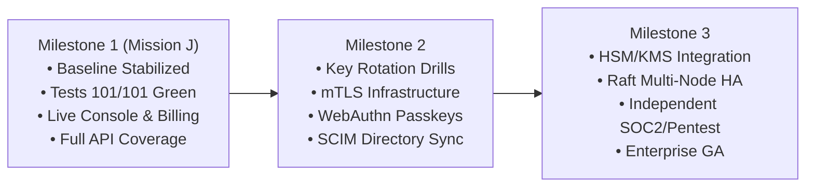

# Implementation Backlog — Mission J

**Prioritized Engineering Backlog for Q-Core Enterprise Maturation**  
**Date:** 2026-10-18  
**Repository:** `https://github.com/vishnuvardhanburri/VARDHAN_Q_CORE-PLATFORM`

---

## 1. Prioritization Framework

Each item is scored across four dimensions:
- **Impact (1–5):** Value to enterprise customers, security defensibility, or operational stability.
- **Effort (1–5):** Engineering complexity, testing rigor, and cross-subsystem coordination.
- **Risk (1–5):** Blast radius of regression, split-brain risk, or cryptographic vulnerability.
- **Priority Tier:**
  - **P0:** Critical Blocker / Baseline Operational Integrity (Must complete in current milestone).
  - **P1:** Enterprise Core Experience & Commercialization (High ROI product capabilities).
  - **P2:** Advanced Infrastructure & Production Hardening (Future release gates).

---

## 2. Priority Backlog Matrix

| ID | Title | Tier | Impact | Effort | Risk | Rationale & Scope | Status |
|---|---|---|:---:|:---:|:---:|---|:---:|
| **SEC-01** | SBOM CI Verification | **P0** | 5 | 2 | 1 | Integrate CycloneDX `cargo sbom` validation into `.github/workflows/security.yml` to eliminate CI failure on `supplyChainSecurity.test.ts`. | **COMPLETED** |
| **INT-01** | Boundary Test Remediation | **P0** | 5 | 3 | 2 | Fix 5 failing `boundary.test.ts` cases by resolving `vardhan-receipt` binary path, accepting schema `1.1`, and using dynamic UUID finding IDs to avoid `REJECTED_REPLAY`. | **COMPLETED** |
| **OPS-01** | Port 8080 Collision Resolution | **P0** | 5 | 3 | 3 | Establish dedicated port assignments: 8080 (Axum control plane), 3000 (React console), 9000 (pq_shield), 8443 (quantum_node TLS). | **COMPLETED** |
| **DOC-01** | Baseline Audit & Limitation Sync | **P0** | 4 | 2 | 1 | Audit repository state, update `docs/KNOWN_LIMITATIONS.md` (L-10 frontend location), and document single-node RC reality. | **COMPLETED** |
| **UI-01** | Enterprise Live Overview Console | **P1** | 5 | 4 | 2 | Build Stripe/Datadog-tier console with 6 KPI cards, live chronologically-sorted activity strip, SVG trend charts, and modal drill-down. | **COMPLETED** |
| **UI-02** | Time-Range Filter Engine | **P1** | 4 | 3 | 1 | Implement unified 24H / 7D / 30D / ALL filtering across all overview telemetry, strictly bound to actual record timestamps. | **COMPLETED** |
| **UI-03** | Bounded Live Polling & Freshness | **P1** | 4 | 3 | 2 | Implement 20s auto-refresh with request abort controllers, stale-data indicators, and tab inactivity throttling. | **COMPLETED** |
| **BIL-01** | Six-Plan Catalog & Subscription UI | **P1** | 5 | 3 | 1 | Integrate `/api/v1/catalog/plans`, render all 6 plans, wire subscription card with verification status and self-serve upgrades. | **COMPLETED** |
| **BIL-02** | Verified Entitlements Enforcement | **P1** | 5 | 3 | 2 | Query `/api/v1/organizations/{id}/entitlements`, decouple subscription existence from capability unlocking. | **COMPLETED** |
| **AUTH-01**| Session Token Rotation Serialization | **P1** | 5 | 3 | 3 | Implement promise queue in `qcore.ts` to handle backend rolling tokens (`authorization-new-token`) without race conditions. | **COMPLETED** |
| **IAM-01** | Member & Invitation Administration | **P1** | 4 | 3 | 1 | Add `AccessView.tsx` supporting member listing, role assignment (`admin`, `operator`, `auditor`, `member`), and invite revoking. | **COMPLETED** |
| **MKT-01** | Competitive Market Map & Differentiation | **P1** | 4 | 3 | 1 | Author comprehensive analysis of 10 market alternatives and document Q-Core's 4 genuine technical differentiators. | **COMPLETED** |
| **CRYP-01**| Hardware Security Module (HSM/KMS) | **P2** | 5 | 5 | 4 | Bind root signing keys to PKCS#11 / AWS CloudHSM instead of software sled storage. Required for Gate G4. | `[PLANNED]` |
| **NET-01** | Mutual TLS (mTLS) Enforcement | **P2** | 5 | 4 | 3 | Enforce client-certificate authentication across all node-to-control-plane communications. Required for Gate G3. | `[PLANNED]` |
| **RAFT-01**| Multi-Node Consensus Promotion | **P2** | 5 | 5 | 5 | Resolve Raft split-brain idempotency under network partitions. Required for Gate G2 and multi-node HA. | `[EXPERIMENTAL]` |
| **AUD-01** | Third-Party Pentest & ISO 27001 | **P2** | 5 | 4 | 2 | Commission accredited independent penetration testing and SOC2/ISO audit. Required for Gate G1. | `[PLANNED]` |
| **OTEL-01**| OpenTelemetry Collector Integration | **P2** | 3 | 3 | 1 | Standardize audit ledger export into OTLP gRPC/HTTP collectors for Datadog and Splunk ingestion. | `[PLANNED]` |

---

## 3. Milestones & Release Path

